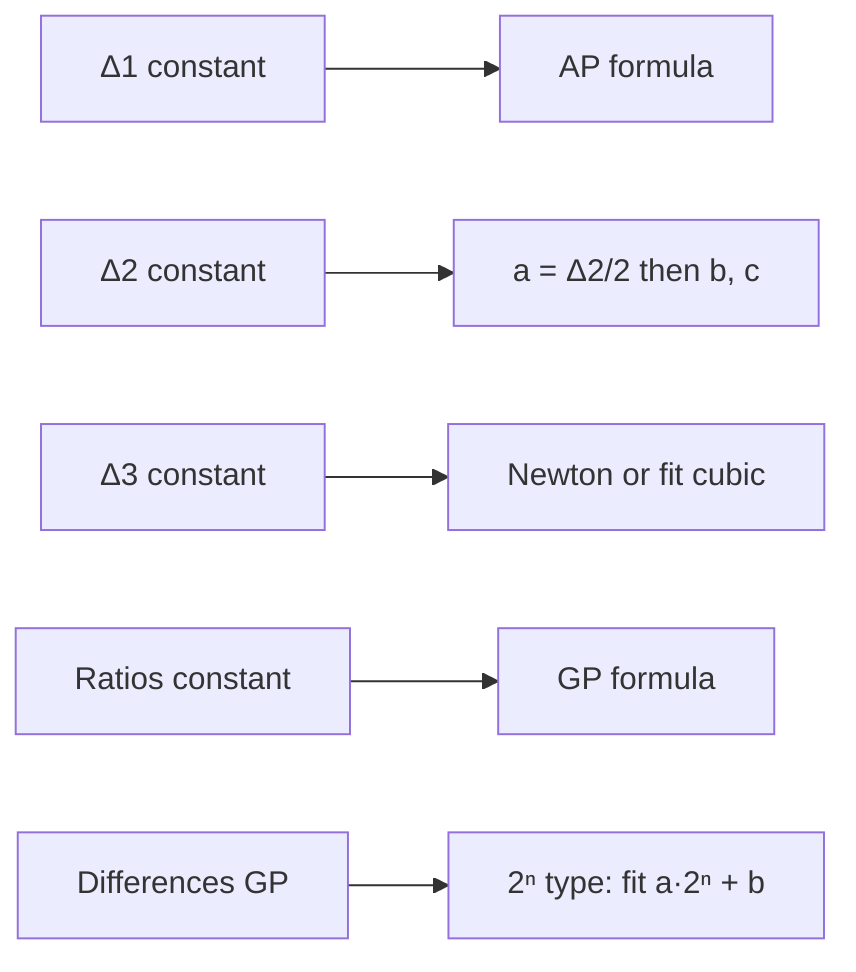
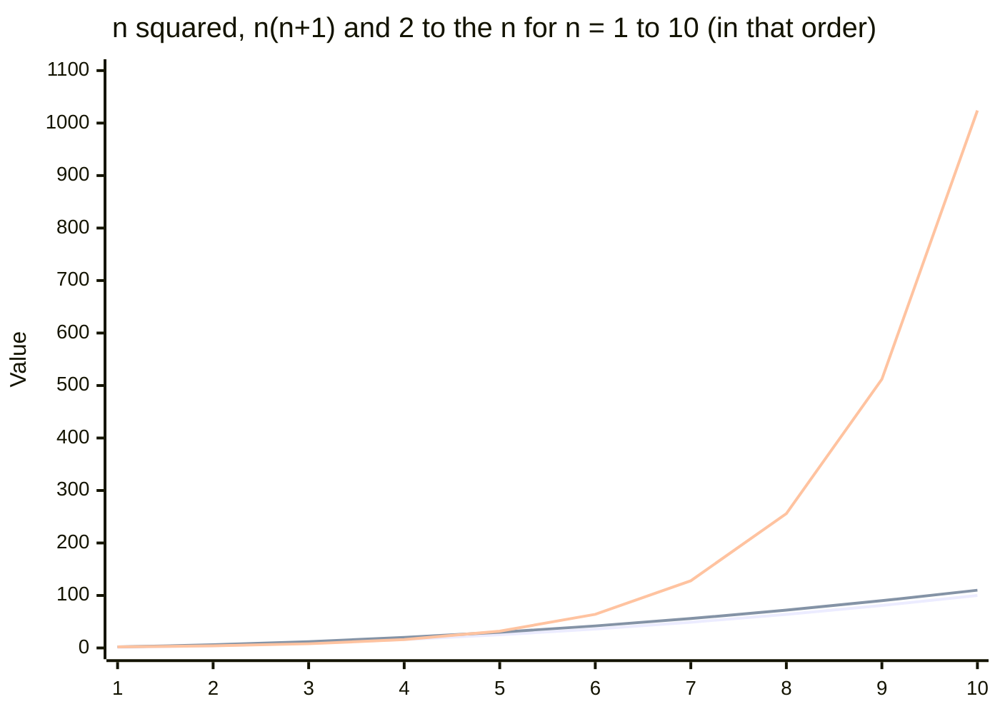

# 📐 NUMBER SERIES — Formulas & Reference Tables

> *Everything you need to look up in 5 seconds.*

| 🏷️ Section | Contents |
|:---:|---|
| 1 | Arithmetic progression (AP) |
| 2 | Geometric progression (GP) |
| 3 | Sums of natural numbers, squares, cubes |
| 4 | Finding the n-th term from differences |
| 5 | Recurrence `t(n+1) = a·t(n) + b` — closed form |
| 6 | Fibonacci family |
| 7 | Polygonal & figurate numbers |
| 8 | Handy identities & shortcuts |
| 9 | Master table n = 1…50 |
| 10 | Primes up to 1000 |
| 11 | Powers table |
| 12 | Factorials, Fibonacci, Lucas, triangular |
| 13 | Number identification table 1…200 |
| 14 | Quick-glance cards |

---

# ➕ 1. Arithmetic Progression (AP)

```text
a = first term     d = common difference     n = number of terms     l = last term
```

| Quantity | Formula | Example (a=5, d=3, n=10) |
|---|---|---|
| n-th term | `tₙ = a + (n−1)d` | 5 + 9×3 = **32** |
| Number of terms | `n = (l − a)/d + 1` | (32−5)/3 + 1 = **10** |
| Sum of n terms | `Sₙ = n/2 · [2a + (n−1)d]` | 5 × (10 + 27) = **185** |
| Sum (first & last known) | `Sₙ = n(a + l)/2` | 10×37/2 = **185** |
| Average | `(a + l)/2` | **18.5** |
| Middle-term property | `tₙ = (tₙ₋ₖ + tₙ₊ₖ)/2` | middle of 8, 14, 20 is 14 |
| Arithmetic mean of 3 terms a, b, c | `2b = a + c` | 8, 11, 14 → 22 = 22 ✔ |

### Special AP sums

| Sum | Formula | Check n = 10 |
|---|---|---|
| 1 + 2 + … + n | `n(n+1)/2` | 55 |
| 1 + 3 + 5 + … (n odd numbers) | `n²` | 100 |
| 2 + 4 + 6 + … (n even numbers) | `n(n+1)` | 110 |

# ✖️ 2. Geometric Progression (GP)

```text
a = first term     r = common ratio     n = number of terms
```

| Quantity | Formula | Example (a=3, r=2, n=6) |
|---|---|---|
| n-th term | `tₙ = a·rⁿ⁻¹` | 3 × 2⁵ = **96** |
| Sum (r > 1) | `Sₙ = a(rⁿ − 1)/(r − 1)` | 3 × 63 = **189** |
| Sum (r < 1) | `Sₙ = a(1 − rⁿ)/(1 − r)` | a=8, r=½, n=3 → **14** |
| Infinite sum (\|r\| < 1) | `S∞ = a/(1 − r)` | 8/(1−½) = **16** |
| Geometric mean of a, b, c | `b² = a·c` | 2, 6, 18 → 36 = 36 ✔ |

# 🧮 3. Sums of Powers

| Sum | Formula | n = 5 | n = 10 |
|---|---|:-:|:-:|
| Σ n | `n(n+1)/2` | 15 | 55 |
| Σ n² | `n(n+1)(2n+1)/6` | 55 | 385 |
| Σ n³ | `[n(n+1)/2]²` | 225 | 3025 |
| Σ odd (first n) | `n²` | 25 | 100 |
| Σ even (first n) | `n(n+1)` | 30 | 110 |
| Σ 2ⁿ (n terms from 2¹) | `2ⁿ⁺¹ − 2` | 62 | 2046 |
| Σ n(n+1) | `n(n+1)(n+2)/3` | 70 | 440 |

**Beautiful fact:** Σn³ = (Σn)². Check: 1³+2³+3³ = 36 = 6².

# 🔬 4. n-th Term from the Difference Table

### 4.1 Quadratic series  `tₙ = an² + bn + c`

```text
  t1   t2   t3   t4
    Δ1₁  Δ1₂  Δ1₃
      Δ2   Δ2

  a = Δ2 / 2
  b = (t2 − t1) − 3a
  c = t1 − a − b
```

**Worked example:** `3, 8, 15, 24, 35`

```text
  Δ1 : 5   7   9   11
  Δ2 : 2   2   2          → a = 1
  b  = (8 − 3) − 3(1) = 2
  c  = 3 − 1 − 2      = 0
  tₙ = n² + 2n          check n=5 → 25+10 = 35 ✔     next n=6 → 36+12 = 48
```

### 4.2 Cubic series  `tₙ = an³ + bn² + cn + d`

```text
  Δ3 constant = 6a      →   a = Δ3 / 6
```

Example: `1, 8, 27, 64` has Δ3 = 6 → a = 1 (it is n³).

### 4.3 Newton's forward-difference formula (universal)

```text
  tₙ = t1 + (n−1)·Δ¹ + (n−1)(n−2)/2 · Δ² + (n−1)(n−2)(n−3)/6 · Δ³ + …
       (Δ¹, Δ², Δ³ are the FIRST entries of each difference row)
```

Example `2, 6, 12, 20`: Δ¹ = 4, Δ² = 2 → t₅ = 2 + 4·4 + (4·3/2)·2 = 2 + 16 + 12 = **30** ✔

### 4.4 Which method when?



# 🔁 5. Linear Recurrence  `t(n+1) = a·t(n) + b`

```text
  Fixed point  p = b / (1 − a)           (value that never changes)
  Closed form  tₙ = (t1 − p)·aⁿ⁻¹ + p
```

| Rule | Fixed point p | Closed form | Check |
|---|:-:|---|---|
| ×2 + 1 (start 3) | −1 | tₙ = 4·2ⁿ⁻¹ − 1 = 2ⁿ⁺¹ − 1 | 3, 7, 15, 31 ✔ |
| ×3 − 2 (start 4) | 1 | tₙ = 3·3ⁿ⁻¹ + 1 = 3ⁿ + 1 | 4, 10, 28, 82 ✔ |
| ×2 − 1 (start 3) | 1 | tₙ = 2·2ⁿ⁻¹ + 1 = 2ⁿ + 1 | 3, 5, 9, 17 ✔ |
| ×2 + 3 (start 1) | −3 | tₙ = 4·2ⁿ⁻¹ − 3 = 2ⁿ⁺¹ − 3 | 1, 5, 13, 29 ✔ |

> 💡 Subtract the fixed point and the series becomes a pure GP. For `3, 7, 15, 31` add 1 to every term: `4, 8, 16, 32` — a GP!

# 🌀 6. Fibonacci Family

| Name | Rule | Start | First terms |
|---|---|---|---|
| Fibonacci | tₙ = tₙ₋₁ + tₙ₋₂ | 1, 1 | 1, 1, 2, 3, 5, 8, 13, 21 |
| Lucas | same | 2, 1 | 2, 1, 3, 4, 7, 11, 18, 29 |
| Tribonacci | sum of previous 3 | 0, 1, 1 | 0, 1, 1, 2, 4, 7, 13, 24 |
| Jacobsthal | tₙ = tₙ₋₁ + 2tₙ₋₂ | 0, 1 | 0, 1, 1, 3, 5, 11, 21, 43 |
| Pell | tₙ = 2tₙ₋₁ + tₙ₋₂ | 0, 1 | 0, 1, 2, 5, 12, 29, 70, 169 |

| Identity | Formula | Check |
|---|---|---|
| Sum of first n Fibonacci | F₁+…+Fₙ = Fₙ₊₂ − 1 | 1+1+2+3+5 = 12 = 13−1 |
| Golden ratio | Fₙ₊₁/Fₙ → φ ≈ 1.618 | 21/13 ≈ 1.615 |
| Binet | Fₙ = (φⁿ − ψⁿ)/√5 | F₁₀ = 55 |

# 🔷 7. Polygonal & Figurate Numbers

| Name | Formula | First 8 terms |
|---|---|---|
| Triangular | `n(n+1)/2` | 1, 3, 6, 10, 15, 21, 28, 36 |
| Square | `n²` | 1, 4, 9, 16, 25, 36, 49, 64 |
| Pentagonal | `n(3n−1)/2` | 1, 5, 12, 22, 35, 51, 70, 92 |
| Hexagonal | `n(2n−1)` | 1, 6, 15, 28, 45, 66, 91, 120 |
| Heptagonal | `n(5n−3)/2` | 1, 7, 18, 34, 55, 81, 112, 148 |
| Octagonal | `n(3n−2)` | 1, 8, 21, 40, 65, 96, 133, 176 |
| Pronic n(n+1) | `n(n+1)` | 2, 6, 12, 20, 30, 42, 56, 72 |
| Tetrahedral | `n(n+1)(n+2)/6` | 1, 4, 10, 20, 35, 56, 84, 120 |
| Centered square | `2n(n−1)+1` | 1, 5, 13, 25, 41, 61, 85, 113 |
| Cube | `n³` | 1, 8, 27, 64, 125, 216, 343, 512 |
| Star (6-pointed) | `6n(n−1)+1` | 1, 13, 37, 73, 121, 181, 253, 337 |

# 🧰 8. Handy Identities & Shortcuts

| Identity | Meaning / use |
|---|---|
| (n+1)² − n² = 2n + 1 | Consecutive squares differ by odd numbers |
| (n+1)³ − n³ = 3n² + 3n + 1 | Consecutive cubes differ by 7, 19, 37, 61 … |
| n³ − n = (n−1)·n·(n+1) | Product of three consecutive numbers (divisible by 6) |
| n² − 1 = (n−1)(n+1) | 3 = 1×3, 8 = 2×4, 15 = 3×5, 24 = 4×6 |
| n(n+1) is always even | Pronic numbers are even |
| a² − b² = (a−b)(a+b) | Fast factorisation |
| Square ending in 5: (10a+5)² = a(a+1) then 25 | 35² → 3×4 = 12, then 25 → **1225** |
| Squares end in 0,1,4,5,6,9 only | Eliminates options |
| Prime > 3 has form 6k ± 1 | Fast primality test |
| Sum of first n odd = n² | 1+3+5+7 = 16 |
| 2ⁿ⁺¹ − 2ⁿ = 2ⁿ | Doubling series differences |

### Last-digit cycles

| Last digit of base | Cycle of last digits of powers |
|:---:|---|
| 2 | 2, 4, 8, 6 |
| 3 | 3, 9, 7, 1 |
| 4 | 4, 6 |
| 7 | 7, 9, 3, 1 |
| 8 | 8, 4, 2, 6 |
| 9 | 9, 1 |
| 0, 1, 5, 6 | stay the same |

### Cube last digit map

| n ends in | 0 | 1 | 2 | 3 | 4 | 5 | 6 | 7 | 8 | 9 |
|:---:|:-:|:-:|:-:|:-:|:-:|:-:|:-:|:-:|:-:|:-:|
| n³ ends in | 0 | 1 | 8 | 7 | 4 | 5 | 6 | 3 | 2 | 9 |

---

# 📊 9. Master Table n = 1 … 50

| n | n² | n³ | n²−1 | n²+1 | n³−1 | n³+1 | n(n+1) | n(n+1)/2 | 2ⁿ |
|:-:|--:|--:|--:|--:|--:|--:|--:|--:|--:|
| 1 | 1 | 1 | 0 | 2 | 0 | 2 | 2 | 1 | 2 |
| 2 | 4 | 8 | 3 | 5 | 7 | 9 | 6 | 3 | 4 |
| 3 | 9 | 27 | 8 | 10 | 26 | 28 | 12 | 6 | 8 |
| 4 | 16 | 64 | 15 | 17 | 63 | 65 | 20 | 10 | 16 |
| 5 | 25 | 125 | 24 | 26 | 124 | 126 | 30 | 15 | 32 |
| 6 | 36 | 216 | 35 | 37 | 215 | 217 | 42 | 21 | 64 |
| 7 | 49 | 343 | 48 | 50 | 342 | 344 | 56 | 28 | 128 |
| 8 | 64 | 512 | 63 | 65 | 511 | 513 | 72 | 36 | 256 |
| 9 | 81 | 729 | 80 | 82 | 728 | 730 | 90 | 45 | 512 |
| 10 | 100 | 1000 | 99 | 101 | 999 | 1001 | 110 | 55 | 1024 |
| 11 | 121 | 1331 | 120 | 122 | 1330 | 1332 | 132 | 66 | 2048 |
| 12 | 144 | 1728 | 143 | 145 | 1727 | 1729 | 156 | 78 | 4096 |
| 13 | 169 | 2197 | 168 | 170 | 2196 | 2198 | 182 | 91 | 8192 |
| 14 | 196 | 2744 | 195 | 197 | 2743 | 2745 | 210 | 105 | 16384 |
| 15 | 225 | 3375 | 224 | 226 | 3374 | 3376 | 240 | 120 | 32768 |
| 16 | 256 | 4096 | 255 | 257 | 4095 | 4097 | 272 | 136 | 65536 |
| 17 | 289 | 4913 | 288 | 290 | 4912 | 4914 | 306 | 153 | 131072 |
| 18 | 324 | 5832 | 323 | 325 | 5831 | 5833 | 342 | 171 | 262144 |
| 19 | 361 | 6859 | 360 | 362 | 6858 | 6860 | 380 | 190 | 524288 |
| 20 | 400 | 8000 | 399 | 401 | 7999 | 8001 | 420 | 210 | 1048576 |
| 21 | 441 | 9261 | 440 | 442 | 9260 | 9262 | 462 | 231 | 2097152 |
| 22 | 484 | 10648 | 483 | 485 | 10647 | 10649 | 506 | 253 | 4194304 |
| 23 | 529 | 12167 | 528 | 530 | 12166 | 12168 | 552 | 276 | 8388608 |
| 24 | 576 | 13824 | 575 | 577 | 13823 | 13825 | 600 | 300 | 16777216 |
| 25 | 625 | 15625 | 624 | 626 | 15624 | 15626 | 650 | 325 | 33554432 |
| 26 | 676 | 17576 | 675 | 677 | 17575 | 17577 | 702 | 351 | 67108864 |
| 27 | 729 | 19683 | 728 | 730 | 19682 | 19684 | 756 | 378 | 134217728 |
| 28 | 784 | 21952 | 783 | 785 | 21951 | 21953 | 812 | 406 | 268435456 |
| 29 | 841 | 24389 | 840 | 842 | 24388 | 24390 | 870 | 435 | 536870912 |
| 30 | 900 | 27000 | 899 | 901 | 26999 | 27001 | 930 | 465 | 1073741824 |
| 31 | 961 | 29791 | 960 | 962 | 29790 | 29792 | 992 | 496 | — |
| 32 | 1024 | 32768 | 1023 | 1025 | 32767 | 32769 | 1056 | 528 | — |
| 33 | 1089 | 35937 | 1088 | 1090 | 35936 | 35938 | 1122 | 561 | — |
| 34 | 1156 | 39304 | 1155 | 1157 | 39303 | 39305 | 1190 | 595 | — |
| 35 | 1225 | 42875 | 1224 | 1226 | 42874 | 42876 | 1260 | 630 | — |
| 36 | 1296 | 46656 | 1295 | 1297 | 46655 | 46657 | 1332 | 666 | — |
| 37 | 1369 | 50653 | 1368 | 1370 | 50652 | 50654 | 1406 | 703 | — |
| 38 | 1444 | 54872 | 1443 | 1445 | 54871 | 54873 | 1482 | 741 | — |
| 39 | 1521 | 59319 | 1520 | 1522 | 59318 | 59320 | 1560 | 780 | — |
| 40 | 1600 | 64000 | 1599 | 1601 | 63999 | 64001 | 1640 | 820 | — |
| 41 | 1681 | 68921 | 1680 | 1682 | 68920 | 68922 | 1722 | 861 | — |
| 42 | 1764 | 74088 | 1763 | 1765 | 74087 | 74089 | 1806 | 903 | — |
| 43 | 1849 | 79507 | 1848 | 1850 | 79506 | 79508 | 1892 | 946 | — |
| 44 | 1936 | 85184 | 1935 | 1937 | 85183 | 85185 | 1980 | 990 | — |
| 45 | 2025 | 91125 | 2024 | 2026 | 91124 | 91126 | 2070 | 1035 | — |
| 46 | 2116 | 97336 | 2115 | 2117 | 97335 | 97337 | 2162 | 1081 | — |
| 47 | 2209 | 103823 | 2208 | 2210 | 103822 | 103824 | 2256 | 1128 | — |
| 48 | 2304 | 110592 | 2303 | 2305 | 110591 | 110593 | 2352 | 1176 | — |
| 49 | 2401 | 117649 | 2400 | 2402 | 117648 | 117650 | 2450 | 1225 | — |
| 50 | 2500 | 125000 | 2499 | 2501 | 124999 | 125001 | 2550 | 1275 | — |

### Growth chart of n², n(n+1) and 2ⁿ



# ⭐ 10. Primes up to 1000

There are **168** primes below 1000 (25 below 100, 46 below 200).

| Block | Primes |
|---|---|
| 0–99 (25) | 2, 3, 5, 7, 11, 13, 17, 19, 23, 29, 31, 37, 41, 43, 47, 53, 59, 61, 67, 71, 73, 79, 83, 89, 97 |
| 100–199 (21) | 101, 103, 107, 109, 113, 127, 131, 137, 139, 149, 151, 157, 163, 167, 173, 179, 181, 191, 193, 197, 199 |
| 200–299 (16) | 211, 223, 227, 229, 233, 239, 241, 251, 257, 263, 269, 271, 277, 281, 283, 293 |
| 300–399 (16) | 307, 311, 313, 317, 331, 337, 347, 349, 353, 359, 367, 373, 379, 383, 389, 397 |
| 400–499 (17) | 401, 409, 419, 421, 431, 433, 439, 443, 449, 457, 461, 463, 467, 479, 487, 491, 499 |
| 500–599 (14) | 503, 509, 521, 523, 541, 547, 557, 563, 569, 571, 577, 587, 593, 599 |
| 600–699 (16) | 601, 607, 613, 617, 619, 631, 641, 643, 647, 653, 659, 661, 673, 677, 683, 691 |
| 700–799 (14) | 701, 709, 719, 727, 733, 739, 743, 751, 757, 761, 769, 773, 787, 797 |
| 800–899 (15) | 809, 811, 821, 823, 827, 829, 839, 853, 857, 859, 863, 877, 881, 883, 887 |
| 900–999 (14) | 907, 911, 919, 929, 937, 941, 947, 953, 967, 971, 977, 983, 991, 997 |

### Twin primes (differ by 2)

| Twin pairs below 200 |
|---|
| (3, 5), (5, 7), (11, 13), (17, 19), (29, 31), (41, 43), (59, 61), (71, 73), (101, 103), (107, 109), (137, 139), (149, 151), (179, 181), (191, 193), (197, 199) |

### Primes that look composite (traps) ⚠️

| Number | Looks like | Actually |
|:-:|---|---|
| 51 | prime | 3 × 17 |
| 57 | prime | 3 × 19 |
| 87 | prime | 3 × 29 |
| 91 | prime | 7 × 13 |
| 119 | prime | 7 × 17 |
| 133 | prime | 7 × 19 |
| 143 | prime | 11 × 13 |
| 161 | prime | 7 × 23 |

# 💥 11. Powers Table

| n | 2ⁿ | 3ⁿ | 4ⁿ | 5ⁿ | 6ⁿ | 7ⁿ |
|:-:|--:|--:|--:|--:|--:|--:|
| 1 | 2 | 3 | 4 | 5 | 6 | 7 |
| 2 | 4 | 9 | 16 | 25 | 36 | 49 |
| 3 | 8 | 27 | 64 | 125 | 216 | 343 |
| 4 | 16 | 81 | 256 | 625 | 1296 | 2401 |
| 5 | 32 | 243 | 1024 | 3125 | 7776 | 16807 |
| 6 | 64 | 729 | 4096 | 15625 | 46656 | 117649 |
| 7 | 128 | 2187 | 16384 | 78125 | 279936 | 823543 |
| 8 | 256 | 6561 | 65536 | 390625 | 1679616 | 5764801 |
| 9 | 512 | 19683 | 262144 | 1953125 | 10077696 | 40353607 |
| 10 | 1024 | 59049 | 1048576 | 9765625 | 60466176 | 282475249 |
| 11 | 2048 | 177147 | 4194304 | 48828125 | 362797056 | 1977326743 |
| 12 | 4096 | 531441 | 16777216 | 244140625 | 2176782336 | 13841287201 |
| 13 | 8192 | 1594323 | 67108864 | 1220703125 | 13060694016 | 96889010407 |
| 14 | 16384 | 4782969 | 268435456 | 6103515625 | 78364164096 | 678223072849 |
| 15 | 32768 | 14348907 | 1073741824 | 30517578125 | 470184984576 | 4747561509943 |

### Fourth and fifth powers

| n | n⁴ | n⁵ |
|:-:|--:|--:|
| 1 | 1 | 1 |
| 2 | 16 | 32 |
| 3 | 81 | 243 |
| 4 | 256 | 1024 |
| 5 | 625 | 3125 |
| 6 | 1296 | 7776 |
| 7 | 2401 | 16807 |
| 8 | 4096 | 32768 |
| 9 | 6561 | 59049 |
| 10 | 10000 | 100000 |
| 11 | 14641 | 161051 |
| 12 | 20736 | 248832 |

# 🧱 12. Factorials, Fibonacci, Lucas & Triangular

### Factorials

| n | n! | n!+1 | n!−1 |
|:-:|--:|--:|--:|
| 0 | 1 | 2 | 0 |
| 1 | 1 | 2 | 0 |
| 2 | 2 | 3 | 1 |
| 3 | 6 | 7 | 5 |
| 4 | 24 | 25 | 23 |
| 5 | 120 | 121 | 119 |
| 6 | 720 | 721 | 719 |
| 7 | 5040 | 5041 | 5039 |
| 8 | 40320 | 40321 | 40319 |
| 9 | 362880 | 362881 | 362879 |
| 10 | 3628800 | 3628801 | 3628799 |
| 11 | 39916800 | 39916801 | 39916799 |
| 12 | 479001600 | 479001601 | 479001599 |

### Fibonacci & Lucas (F₀…F₂₅)

| n | Fₙ | Lₙ | Fₙ₊₁/Fₙ |
|:-:|--:|--:|--:|
| 0 | 0 | 2 | — |
| 1 | 1 | 1 | 1.0000 |
| 2 | 1 | 3 | 2.0000 |
| 3 | 2 | 4 | 1.5000 |
| 4 | 3 | 7 | 1.6667 |
| 5 | 5 | 11 | 1.6000 |
| 6 | 8 | 18 | 1.6250 |
| 7 | 13 | 29 | 1.6154 |
| 8 | 21 | 47 | 1.6190 |
| 9 | 34 | 76 | 1.6176 |
| 10 | 55 | 123 | 1.6182 |
| 11 | 89 | 199 | 1.6180 |
| 12 | 144 | 322 | 1.6181 |
| 13 | 233 | 521 | 1.6180 |
| 14 | 377 | 843 | 1.6180 |
| 15 | 610 | 1364 | 1.6180 |
| 16 | 987 | 2207 | 1.6180 |
| 17 | 1597 | 3571 | 1.6180 |
| 18 | 2584 | 5778 | 1.6180 |
| 19 | 4181 | 9349 | 1.6180 |
| 20 | 6765 | 15127 | 1.6180 |
| 21 | 10946 | 24476 | 1.6180 |
| 22 | 17711 | 39603 | 1.6180 |
| 23 | 28657 | 64079 | 1.6180 |
| 24 | 46368 | 103682 | 1.6180 |
| 25 | 75025 | 167761 | 1.6180 |

### Triangular numbers T₁ … T₃₀

| n | Tₙ | n | Tₙ | n | Tₙ |
|:-:|--:|:-:|--:|:-:|--:|
| 1 | 1 | 11 | 66 | 21 | 231 |
| 2 | 3 | 12 | 78 | 22 | 253 |
| 3 | 6 | 13 | 91 | 23 | 276 |
| 4 | 10 | 14 | 105 | 24 | 300 |
| 5 | 15 | 15 | 120 | 25 | 325 |
| 6 | 21 | 16 | 136 | 26 | 351 |
| 7 | 28 | 17 | 153 | 27 | 378 |
| 8 | 36 | 18 | 171 | 28 | 406 |
| 9 | 45 | 19 | 190 | 29 | 435 |
| 10 | 55 | 20 | 210 | 30 | 465 |

---

# 🔎 13. Number Identification Table 1 … 200

> When a series contains a number you recognise, this table tells you *what it is*. Tags: `k²` square · `k³` cube · `Tk` triangular · `Fib` · `2^k` · `k!` · `k(k+1)` pronic · `k²±1` · `k³±1`.

| N | Prime factorisation | Tags |
|:-:|---|---|
| 1 | 1 | 1² · 1³ · T1 · Fib |
| 2 | 2 | ⭐ prime · Fib · 2^1 · 1(2) · 1²+1 |
| 3 | 3 | ⭐ prime · T2 · Fib · 2²−1 |
| 4 | 2² | 2² · 2^2 |
| 5 | 5 | ⭐ prime · Fib · 2²+1 |
| 6 | 2 × 3 | T3 · 3! · 2(3) |
| 7 | 7 | ⭐ prime · 2³−1 |
| 8 | 2³ | 2³ · Fib · 2^3 · 3²−1 |
| 9 | 3² | 3² · 2³+1 |
| 10 | 2 × 5 | T4 · 3²+1 |
| 11 | 11 | ⭐ prime |
| 12 | 2² × 3 | 3(4) |
| 13 | 13 | ⭐ prime · Fib |
| 14 | 2 × 7 | · |
| 15 | 3 × 5 | T5 · 4²−1 |
| 16 | 2⁴ | 4² · 2^4 |
| 17 | 17 | ⭐ prime · 4²+1 |
| 18 | 2 × 3² | · |
| 19 | 19 | ⭐ prime |
| 20 | 2² × 5 | 4(5) |
| 21 | 3 × 7 | T6 · Fib |
| 22 | 2 × 11 | · |
| 23 | 23 | ⭐ prime |
| 24 | 2³ × 3 | 4! · 5²−1 |
| 25 | 5² | 5² |
| 26 | 2 × 13 | 5²+1 · 3³−1 |
| 27 | 3³ | 3³ |
| 28 | 2² × 7 | T7 · 3³+1 |
| 29 | 29 | ⭐ prime |
| 30 | 2 × 3 × 5 | 5(6) |
| 31 | 31 | ⭐ prime |
| 32 | 2⁵ | 2^5 |
| 33 | 3 × 11 | · |
| 34 | 2 × 17 | Fib |
| 35 | 5 × 7 | 6²−1 |
| 36 | 2² × 3² | 6² · T8 |
| 37 | 37 | ⭐ prime · 6²+1 |
| 38 | 2 × 19 | · |
| 39 | 3 × 13 | · |
| 40 | 2³ × 5 | · |
| 41 | 41 | ⭐ prime |
| 42 | 2 × 3 × 7 | 6(7) |
| 43 | 43 | ⭐ prime |
| 44 | 2² × 11 | · |
| 45 | 3² × 5 | T9 |
| 46 | 2 × 23 | · |
| 47 | 47 | ⭐ prime |
| 48 | 2⁴ × 3 | 7²−1 |
| 49 | 7² | 7² |
| 50 | 2 × 5² | 7²+1 |
| 51 | 3 × 17 | · |
| 52 | 2² × 13 | · |
| 53 | 53 | ⭐ prime |
| 54 | 2 × 3³ | · |
| 55 | 5 × 11 | T10 · Fib |
| 56 | 2³ × 7 | 7(8) |
| 57 | 3 × 19 | · |
| 58 | 2 × 29 | · |
| 59 | 59 | ⭐ prime |
| 60 | 2² × 3 × 5 | · |
| 61 | 61 | ⭐ prime |
| 62 | 2 × 31 | · |
| 63 | 3² × 7 | 8²−1 · 4³−1 |
| 64 | 2⁶ | 8² · 4³ · 2^6 |
| 65 | 5 × 13 | 8²+1 · 4³+1 |
| 66 | 2 × 3 × 11 | T11 |
| 67 | 67 | ⭐ prime |
| 68 | 2² × 17 | · |
| 69 | 3 × 23 | · |
| 70 | 2 × 5 × 7 | · |
| 71 | 71 | ⭐ prime |
| 72 | 2³ × 3² | 8(9) |
| 73 | 73 | ⭐ prime |
| 74 | 2 × 37 | · |
| 75 | 3 × 5² | · |
| 76 | 2² × 19 | · |
| 77 | 7 × 11 | · |
| 78 | 2 × 3 × 13 | T12 |
| 79 | 79 | ⭐ prime |
| 80 | 2⁴ × 5 | 9²−1 |
| 81 | 3⁴ | 9² |
| 82 | 2 × 41 | 9²+1 |
| 83 | 83 | ⭐ prime |
| 84 | 2² × 3 × 7 | · |
| 85 | 5 × 17 | · |
| 86 | 2 × 43 | · |
| 87 | 3 × 29 | · |
| 88 | 2³ × 11 | · |
| 89 | 89 | ⭐ prime · Fib |
| 90 | 2 × 3² × 5 | 9(10) |
| 91 | 7 × 13 | T13 |
| 92 | 2² × 23 | · |
| 93 | 3 × 31 | · |
| 94 | 2 × 47 | · |
| 95 | 5 × 19 | · |
| 96 | 2⁵ × 3 | · |
| 97 | 97 | ⭐ prime |
| 98 | 2 × 7² | · |
| 99 | 3² × 11 | 10²−1 |
| 100 | 2² × 5² | 10² |
| 101 | 101 | ⭐ prime · 10²+1 |
| 102 | 2 × 3 × 17 | · |
| 103 | 103 | ⭐ prime |
| 104 | 2³ × 13 | · |
| 105 | 3 × 5 × 7 | T14 |
| 106 | 2 × 53 | · |
| 107 | 107 | ⭐ prime |
| 108 | 2² × 3³ | · |
| 109 | 109 | ⭐ prime |
| 110 | 2 × 5 × 11 | 10(11) |
| 111 | 3 × 37 | · |
| 112 | 2⁴ × 7 | · |
| 113 | 113 | ⭐ prime |
| 114 | 2 × 3 × 19 | · |
| 115 | 5 × 23 | · |
| 116 | 2² × 29 | · |
| 117 | 3² × 13 | · |
| 118 | 2 × 59 | · |
| 119 | 7 × 17 | · |
| 120 | 2³ × 3 × 5 | T15 · 5! · 11²−1 |
| 121 | 11² | 11² |
| 122 | 2 × 61 | 11²+1 |
| 123 | 3 × 41 | · |
| 124 | 2² × 31 | 5³−1 |
| 125 | 5³ | 5³ |
| 126 | 2 × 3² × 7 | 5³+1 |
| 127 | 127 | ⭐ prime |
| 128 | 2⁷ | 2^7 |
| 129 | 3 × 43 | · |
| 130 | 2 × 5 × 13 | · |
| 131 | 131 | ⭐ prime |
| 132 | 2² × 3 × 11 | 11(12) |
| 133 | 7 × 19 | · |
| 134 | 2 × 67 | · |
| 135 | 3³ × 5 | · |
| 136 | 2³ × 17 | T16 |
| 137 | 137 | ⭐ prime |
| 138 | 2 × 3 × 23 | · |
| 139 | 139 | ⭐ prime |
| 140 | 2² × 5 × 7 | · |
| 141 | 3 × 47 | · |
| 142 | 2 × 71 | · |
| 143 | 11 × 13 | 12²−1 |
| 144 | 2⁴ × 3² | 12² · Fib |
| 145 | 5 × 29 | 12²+1 |
| 146 | 2 × 73 | · |
| 147 | 3 × 7² | · |
| 148 | 2² × 37 | · |
| 149 | 149 | ⭐ prime |
| 150 | 2 × 3 × 5² | · |
| 151 | 151 | ⭐ prime |
| 152 | 2³ × 19 | · |
| 153 | 3² × 17 | T17 |
| 154 | 2 × 7 × 11 | · |
| 155 | 5 × 31 | · |
| 156 | 2² × 3 × 13 | 12(13) |
| 157 | 157 | ⭐ prime |
| 158 | 2 × 79 | · |
| 159 | 3 × 53 | · |
| 160 | 2⁵ × 5 | · |
| 161 | 7 × 23 | · |
| 162 | 2 × 3⁴ | · |
| 163 | 163 | ⭐ prime |
| 164 | 2² × 41 | · |
| 165 | 3 × 5 × 11 | · |
| 166 | 2 × 83 | · |
| 167 | 167 | ⭐ prime |
| 168 | 2³ × 3 × 7 | 13²−1 |
| 169 | 13² | 13² |
| 170 | 2 × 5 × 17 | 13²+1 |
| 171 | 3² × 19 | T18 |
| 172 | 2² × 43 | · |
| 173 | 173 | ⭐ prime |
| 174 | 2 × 3 × 29 | · |
| 175 | 5² × 7 | · |
| 176 | 2⁴ × 11 | · |
| 177 | 3 × 59 | · |
| 178 | 2 × 89 | · |
| 179 | 179 | ⭐ prime |
| 180 | 2² × 3² × 5 | · |
| 181 | 181 | ⭐ prime |
| 182 | 2 × 7 × 13 | 13(14) |
| 183 | 3 × 61 | · |
| 184 | 2³ × 23 | · |
| 185 | 5 × 37 | · |
| 186 | 2 × 3 × 31 | · |
| 187 | 11 × 17 | · |
| 188 | 2² × 47 | · |
| 189 | 3³ × 7 | · |
| 190 | 2 × 5 × 19 | T19 |
| 191 | 191 | ⭐ prime |
| 192 | 2⁶ × 3 | · |
| 193 | 193 | ⭐ prime |
| 194 | 2 × 97 | · |
| 195 | 3 × 5 × 13 | 14²−1 |
| 196 | 2² × 7² | 14² |
| 197 | 197 | ⭐ prime · 14²+1 |
| 198 | 2 × 3² × 11 | · |
| 199 | 199 | ⭐ prime |
| 200 | 2³ × 5² | · |

---

# 🃏 14. Quick-Glance Cards

### Card 1 — Which formula for which pattern?

| Pattern seen | Use |
|---|---|
| Constant Δ1 | `a + (n−1)d` |
| Constant ratio | `a·rⁿ⁻¹` |
| Constant Δ2 | `an² + bn + c` with a = Δ2/2 |
| ×a + b | fixed point `p = b/(1−a)`, then GP on (t − p) |
| Sum asked | use Section 3 |

### Card 2 — Ten numbers to recognise instantly

| 121 = 11² | 125 = 5³ | 128 = 2⁷ | 144 = 12² = Fib | 169 = 13² |
|---|---|---|---|---|
| 196 = 14² | 216 = 6³ | 225 = 15² | 256 = 2⁸ = 4⁴ | 343 = 7³ |

### Card 3 — Mnemonics

| Memory aid | Meaning |
|---|---|
| **SPOT** | Scan, Patterns of difference, Operations, Test |
| **2-4-8-6** | Last digits of powers of 2 |
| **1-3-6-10-15** | Triangular numbers: add 2, 3, 4, 5 … |
| **1-1-2-3-5-8** | Fibonacci: add the last two |
| **+1, ×2, +2, ×3 …** | Increasing operation pairs |

### Card 4 — Fast squares

| Technique | Example |
|---|---|
| Ends in 5 | 65² → 6×7 = 42 → **4225** |
| Near 50 | 52² = 2500 + 2×50×2 + 4 = **2704** |
| Near 100 | 103² = 10000 + 600 + 9 = **10609** |
| (a+b)² | 23² = 400 + 120 + 9 = **529** |

➡️ Continue with `practice.md` to apply these.