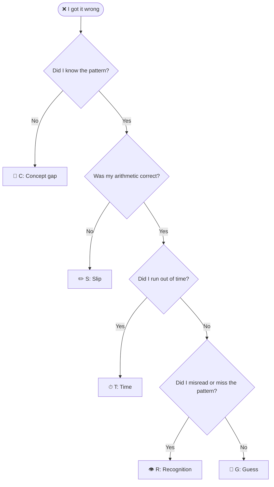
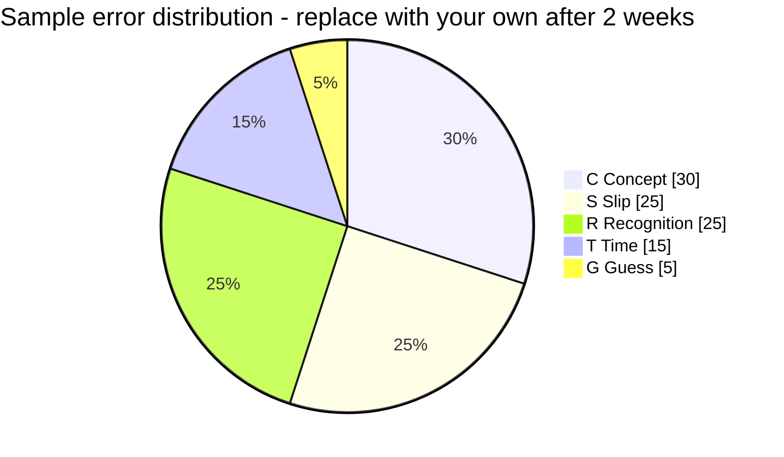
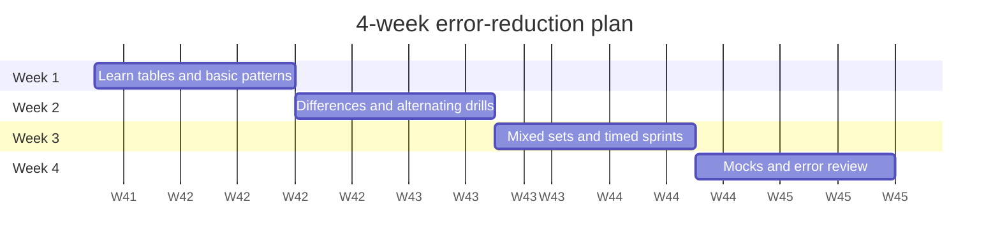

# 🐞 NUMBER SERIES — Mistakes & Error Log

> *You do not rise to the level of your goals — you fall to the level of your error tracking.*

| 📁 Use this file to | |
|---|---|
| 🔍 Learn the 40 most common mistakes | Section 2 |
| 📝 Log your own mistakes | Section 4 |
| 📈 Track accuracy daily | Section 5 |
| 🛠 Fix weaknesses with drills | Sections 6–8 |

---

# 🏷️ 1. Error Taxonomy (C / S / T / R / G)

> **Assumed meaning of the tags** (edit if your own scheme differs): **C**oncept · **S**lip · **T**ime · **R**ecognition · **G**uess.

| Tag | Meaning | Typical cause | Primary cure |
|:-:|---|---|---|
| 🧠 **C** | Concept gap | Don't know the pattern / formula | Re-read `notes.md`, learn from `formulas.md` |
| ✏️ **S** | Silly slip | Arithmetic, copying, sign | Slow down on last step, re-verify |
| ⏱ **T** | Time pressure | Over-thinking, slow identification | Timed drills, hard stop 45 s |
| 👁️ **R** | Recognition / reading | Missed pattern or misread stem | Fingerprint table, SPOT method |
| 🎲 **G** | Guess | Random or unprincipled answer | Elimination first, guess only with 1+ option removed |





| Tag | Priority action if this tag is your top error |
|:-:|---|
| C | 60 % of time on notes + formulas, then easy questions |
| S | Add a verification step; practise mental subtraction |
| T | Daily 10-question sprint at 30 s each |
| R | Do 15 mixed questions; name the pattern *before* solving |
| G | Rule: no guess without eliminating an option |

---

# 🔍 2. The 40 Most Common Mistakes

| ID | Tag | Mistake |
|:-:|:-:|---|
| M01 | 👁️ R | Stopping after Δ1 |
| M02 | 👁️ R | Not comparing with squares/cubes |
| M03 | ✏️ S | Subtraction slip in Δ1 |
| M04 | 🧠 C | Calling a composite 'prime' |
| M05 | 🧠 C | Squares of primes vs squares of naturals |
| M06 | 👁️ R | Missing an alternating pattern |
| M07 | 🧠 C | Trusting a rule built on one pair |
| M08 | 👁️ R | Wrong starting index for n² ± k |
| M09 | ✏️ S | Cube memory error |
| M10 | ✏️ S | Square memory error |
| M11 | ⏱ T | Over-investing in a single question |
| M12 | 🧠 C | Assuming Fibonacci must start 1, 1 |
| M13 | 👁️ R | Building the rule from the wrong term |
| M14 | 👁️ R | Missing a wrong first term |
| M15 | ✏️ S | Sign slip in a descending series |
| M16 | 🧠 C | Expecting terms to be squares when Δ1 are squares |
| M17 | 👁️ R | Confusing AP-of-differences with GP |
| M18 | 🧠 C | Missing decimal ratios |
| M19 | 👁️ R | Mis-assigning positions in interleaved series |
| M20 | 🧠 C | Believing the rule is always unique |
| M21 | 👁️ R | Missing a growing multiplier |
| M22 | ✏️ S | Falling for a fake prime |
| M23 | 🧠 C | Ignoring group series |
| M24 | ⏱ T | Computing options instead of eliminating |
| M25 | 👁️ R | Missing a slowly decreasing gap |
| M26 | 🧠 C | Mixing up n³ − n |
| M27 | ✏️ S | Power-of-2 slip |
| M28 | 🎲 G | Guessing without elimination |
| M29 | 👁️ R | Answering one term when two were asked |
| M30 | 🧠 C | Confusing triangular with square |
| M31 | 👁️ R | Overlooking letter-number mixes |
| M32 | 🧠 C | Sign of the constant in ×a ± b |
| M33 | ✏️ S | Copy error from question to scratch |
| M34 | 👁️ R | Not noticing zero / negative terms |
| M35 | 🧠 C | Not using the n-th term formula |
| M36 | 👁️ R | Missing two interleaved APs |
| M37 | 🧠 C | Missing the error in Fibonacci-type wrong-number |
| M38 | ⏱ T | Starting with the hardest method |
| M39 | 👁️ R | Missing repeated-digit or reversal patterns |
| M40 | 🎲 G | Guessing under negative marking |

---

### 🔴 M01 · [R] Stopping after Δ1

| ❌ Wrong approach | ✅ Right approach |
|---|---|
| Δ1 not constant, so 'no pattern'. | Also check Δ2, ratios, squares, cubes. |

- 📌 **Example:** `2, 5, 10, 17, 26, ?` → Δ1 = 3, 5, 7, 9; Δ2 = 2 → n² + 1 → **37**
- 🩹 **Fix / drill:** Write Δ1 **and** Δ2 for 10 series.
- 🏷️ **Category:** 👁️ Recognition

### 🔴 M02 · [R] Not comparing with squares/cubes

| ❌ Wrong approach | ✅ Right approach |
|---|---|
| Treating 5, 10, 17, 26, 37 as 'random'. | Compare with the square table: each is n² + 1. |

- 📌 **Example:** `5, 10, 17, 26, 37, ?` → 2²+1, 3²+1 … → 7²+1 = **50**
- 🩹 **Fix / drill:** Memorise squares to 20 and cubes to 10.
- 🏷️ **Category:** 👁️ Recognition

### 🔴 M03 · [S] Subtraction slip in Δ1

| ❌ Wrong approach | ✅ Right approach |
|---|---|
| 40 − 25 = 14. | 40 − 25 = 15. Recompute each gap once. |

- 📌 **Example:** `7, 14, 25, 40, 59, ?` → Δ1 = 7, 11, 15, 19 → next 23 → **82**
- 🩹 **Fix / drill:** Re-verify every gap with addition.
- 🏷️ **Category:** ✏️ Slip

### 🔴 M04 · [C] Calling a composite 'prime'

| ❌ Wrong approach | ✅ Right approach |
|---|---|
| Treating 15 as the next prime after 13. | 15 = 3×5. Use the prime list. |

- 📌 **Example:** `5, 7, 11, 13, ?` → **17**
- 🩹 **Fix / drill:** Learn primes below 100 by heart.
- 🏷️ **Category:** 🧠 Concept

### 🔴 M05 · [C] Squares of primes vs squares of naturals

| ❌ Wrong approach | ✅ Right approach |
|---|---|
| `4, 9, 25, 49` → next 81 (squares of 2,3,4…) | Bases are 2, 3, 5, 7 — primes, so next is 11². |

- 📌 **Example:** `4, 9, 25, 49, ?` → **121**
- 🩹 **Fix / drill:** Always list the *bases* of squares.
- 🏷️ **Category:** 🧠 Concept

### 🔴 M06 · [R] Missing an alternating pattern

| ❌ Wrong approach | ✅ Right approach |
|---|---|
| Forcing one rule on a zig-zag series. | Split odd and even positions. |

- 📌 **Example:** `2, 10, 4, 20, 8, 40, ?` → odd: 2,4,8 · even: 10,20,40 → **16**
- 🩹 **Fix / drill:** Circle odd positions in one colour.
- 🏷️ **Category:** 👁️ Recognition

### 🔴 M07 · [C] Trusting a rule built on one pair

| ❌ Wrong approach | ✅ Right approach |
|---|---|
| 3 → 5 as '×1 + 2'. | Test the second pair: 5 → 9 needs ×2 − 1. |

- 📌 **Example:** `3, 5, 9, 17, ?` → ×2 − 1 → **33**
- 🩹 **Fix / drill:** Always verify on ≥ 2 pairs.
- 🏷️ **Category:** 🧠 Concept

### 🔴 M08 · [R] Wrong starting index for n² ± k

| ❌ Wrong approach | ✅ Right approach |
|---|---|
| Starting n at 2 for `0, 3, 8, 15`. | 0 = 1² − 1, so n starts at 1. |

- 📌 **Example:** `0, 3, 8, 15, 24, ?` → 6² − 1 = **35**
- 🩹 **Fix / drill:** Match the first term to its n before extending.
- 🏷️ **Category:** 👁️ Recognition

### 🔴 M09 · [S] Cube memory error

| ❌ Wrong approach | ✅ Right approach |
|---|---|
| 13³ = 2179. | 13³ = 2197. |

- 📌 **Example:** 11³ = 1331 · 12³ = 1728 · 13³ = **2197** · 14³ = 2744 · 15³ = 3375
- 🩹 **Fix / drill:** Rewrite the cube table daily for a week.
- 🏷️ **Category:** ✏️ Slip

### 🔴 M10 · [S] Square memory error

| ❌ Wrong approach | ✅ Right approach |
|---|---|
| 17² = 279, 18² = 342. | 17² = 289, 18² = 324, 19² = 361. |

- 📌 **Example:** 23² = **529** · 24² = 576 · 25² = 625
- 🩹 **Fix / drill:** Use (a+b)² to rebuild a square quickly.
- 🏷️ **Category:** ✏️ Slip

### 🔴 M11 · [T] Over-investing in a single question

| ❌ Wrong approach | ✅ Right approach |
|---|---|
| Spending 2 minutes on one series. | Hard stop at 45 s: mark and move. |

- 📌 **Example:** Any stubborn series
- 🩹 **Fix / drill:** Practise with a visible timer.
- 🏷️ **Category:** ⏱ Time

### 🔴 M12 · [C] Assuming Fibonacci must start 1, 1

| ❌ Wrong approach | ✅ Right approach |
|---|---|
| Rejecting a sum-of-two rule for `2, 5, 7, 12, 19`. | Any start works: each term = sum of previous two. |

- 📌 **Example:** `2, 5, 7, 12, 19, ?` → 12 + 19 = **31**
- 🩹 **Fix / drill:** Test `t₃ = t₁ + t₂` early.
- 🏷️ **Category:** 🧠 Concept

### 🔴 M13 · [R] Building the rule from the wrong term

| ❌ Wrong approach | ✅ Right approach |
|---|---|
| Using the corrupted term to find the pattern. | Use the cleanest middle terms. |

- 📌 **Example:** `10, 14, 18, 22, 27, 30, 34` → AP +4 → **27** is wrong (should be 26)
- 🩹 **Fix / drill:** Fix the rule first, then test each term.
- 🏷️ **Category:** 👁️ Recognition

### 🔴 M14 · [R] Missing a wrong first term

| ❌ Wrong approach | ✅ Right approach |
|---|---|
| Assuming the first term is always right. | Check backwards from the pattern too. |

- 📌 **Example:** `9, 8, 16, 32, 64, 128` → ×2 from 8 → **9** is wrong (should be 4)
- 🩹 **Fix / drill:** Run the rule backwards one step.
- 🏷️ **Category:** 👁️ Recognition

### 🔴 M15 · [S] Sign slip in a descending series

| ❌ Wrong approach | ✅ Right approach |
|---|---|
| 4 − 64 = 60. | 4 − 64 = −60. |

- 📌 **Example:** `64, 60, 52, 36, 4, ?` → Δ1 = −4, −8, −16, −32 → next −64 → **−60**
- 🩹 **Fix / drill:** Circle the sign of every Δ.
- 🏷️ **Category:** ✏️ Slip

### 🔴 M16 · [C] Expecting terms to be squares when Δ1 are squares

| ❌ Wrong approach | ✅ Right approach |
|---|---|
| Searching for squares in `1, 5, 14, 30, 55`. | Differences 4, 9, 16, 25 are the squares. |

- 📌 **Example:** `1, 5, 14, 30, 55, ?` → +36 → **91**
- 🩹 **Fix / drill:** Say aloud: 'terms or gaps?'
- 🏷️ **Category:** 🧠 Concept

### 🔴 M17 · [R] Confusing AP-of-differences with GP

| ❌ Wrong approach | ✅ Right approach |
|---|---|
| `3, 6, 12, 24` looks like gaps doubling. | The terms themselves double → GP ×2. |

- 📌 **Example:** `3, 6, 12, 24, ?` → **48**
- 🩹 **Fix / drill:** Check ratio before differences of differences.
- 🏷️ **Category:** 👁️ Recognition

### 🔴 M18 · [C] Missing decimal ratios

| ❌ Wrong approach | ✅ Right approach |
|---|---|
| 8, 12, 18, 27 treated as random. | Ratio 1.5 each time. |

- 📌 **Example:** `8, 12, 18, 27, 40.5, ?` → **60.75**
- 🩹 **Fix / drill:** Divide consecutive terms when integers don't fit.
- 🏷️ **Category:** 🧠 Concept

### 🔴 M19 · [R] Mis-assigning positions in interleaved series

| ❌ Wrong approach | ✅ Right approach |
|---|---|
| Taking pairs of adjacent terms instead of alternate ones. | Odd and even positions form separate series. |

- 📌 **Example:** `1, 3, 2, 6, 3, 9, 4, ?` → even positions 3,6,9 → **12**
- 🩹 **Fix / drill:** Number the positions above the series.
- 🏷️ **Category:** 👁️ Recognition

### 🔴 M20 · [C] Believing the rule is always unique

| ❌ Wrong approach | ✅ Right approach |
|---|---|
| Rejecting 14 and 16 equally for `2, 4, 8, ?`. | Prefer the simplest rule fitting *all* terms; options help. |

- 📌 **Example:** `2, 4, 8, 16, 32` → ×2 survives; the 'differences' rule fails
- 🩹 **Fix / drill:** Ask for more terms mentally: does the rule still fit?
- 🏷️ **Category:** 🧠 Concept

### 🔴 M21 · [R] Missing a growing multiplier

| ❌ Wrong approach | ✅ Right approach |
|---|---|
| Seeing ×3 or ×4 constant. | Multipliers ×1, ×2, ×3 … with +1. |

- 📌 **Example:** `1, 2, 5, 16, 65, ?` → ×1+1, ×2+1, ×3+1, ×4+1, ×5+1 → **326**
- 🩹 **Fix / drill:** Compute rough ratios: 2, 2.5, 3.2, 4.06, 5.02.
- 🏷️ **Category:** 👁️ Recognition

### 🔴 M22 · [S] Falling for a fake prime

| ❌ Wrong approach | ✅ Right approach |
|---|---|
| Thinking 91 is prime. | 91 = 7 × 13. |

- 📌 **Example:** `71, 73, 79, 83, 89, ?` → skip 91 → **97**
- 🩹 **Fix / drill:** Memorise: 51, 57, 87, 91, 119, 133, 143 are *not* prime.
- 🏷️ **Category:** ✏️ Slip

### 🔴 M23 · [C] Ignoring group series

| ❌ Wrong approach | ✅ Right approach |
|---|---|
| Forcing a single sequence on groups. | Rule works inside each group. |

- 📌 **Example:** `(2,3,6) (4,5,20) (6,7,?)` → a × b → **42**
- 🩹 **Fix / drill:** Look for brackets or repeated structure.
- 🏷️ **Category:** 🧠 Concept

### 🔴 M24 · [T] Computing options instead of eliminating

| ❌ Wrong approach | ✅ Right approach |
|---|---|
| Calculating each option fully. | Use last-digit/parity elimination. |

- 📌 **Example:** `3, 8, 15, 24, ?` → squares − 1 ends only in 0, 3, 4, 5, 8 or 9
- 🩹 **Fix / drill:** Write last digits of the options first.
- 🏷️ **Category:** ⏱ Time

### 🔴 M25 · [R] Missing a slowly decreasing gap

| ❌ Wrong approach | ✅ Right approach |
|---|---|
| Seeing only 'falling numbers'. | Δ1 changes by +1 each time. |

- 📌 **Example:** `100, 91, 83, 76, 70, ?` → Δ1 = −9, −8, −7, −6 → −5 → **65**
- 🩹 **Fix / drill:** Write Δ1 below every falling series.
- 🏷️ **Category:** 👁️ Recognition

### 🔴 M26 · [C] Mixing up n³ − n

| ❌ Wrong approach | ✅ Right approach |
|---|---|
| Taking 6, 24, 60 as ×4, ×2.5. | n³ − n = (n−1)n(n+1). |

- 📌 **Example:** `6, 24, 60, 120, 210, ?` → 7³ − 7 = **336**
- 🩹 **Fix / drill:** Learn 6, 24, 60, 120, 210, 336 as a block.
- 🏷️ **Category:** 🧠 Concept

### 🔴 M27 · [S] Power-of-2 slip

| ❌ Wrong approach | ✅ Right approach |
|---|---|
| 2⁷ = 64. | 2⁷ = 128, 2⁸ = 256, 2⁹ = 512. |

- 📌 **Example:** `3, 5, 9, 17, 33, 65, ?` → 2⁷ + 1 = **129**
- 🩹 **Fix / drill:** Write the 2ⁿ table from memory daily.
- 🏷️ **Category:** ✏️ Slip

### 🔴 M28 · [G] Guessing without elimination

| ❌ Wrong approach | ✅ Right approach |
|---|---|
| Picking an option at random. | Eliminate by parity, size, last digit first. |

- 📌 **Example:** `3, 8, 15, 24, ?` options 33 / 34 / 35 / 36 → n² − 1 → **35**
- 🩹 **Fix / drill:** Guess only after removing ≥ 1 option.
- 🏷️ **Category:** 🎲 Guess

### 🔴 M29 · [R] Answering one term when two were asked

| ❌ Wrong approach | ✅ Right approach |
|---|---|
| Giving only the next term. | Read the question stem twice. |

- 📌 **Example:** `1, 4, 9, ?, ?` → **16, 25**
- 🩹 **Fix / drill:** Underline 'next two' or 'missing'.
- 🏷️ **Category:** 👁️ Recognition

### 🔴 M30 · [C] Confusing triangular with square

| ❌ Wrong approach | ✅ Right approach |
|---|---|
| `1, 3, 6, 10, 15` → next 25. | Δ1 = 2, 3, 4, 5 → +6. |

- 📌 **Example:** `1, 3, 6, 10, 15, ?` → **21**
- 🩹 **Fix / drill:** Learn T₁…T₁₅.
- 🏷️ **Category:** 🧠 Concept

### 🔴 M31 · [R] Overlooking letter-number mixes

| ❌ Wrong approach | ✅ Right approach |
|---|---|
| Treating `A1, C3, E5` as one series. | Letters step +2, numbers step +2 separately. |

- 📌 **Example:** `A1, C3, E5, ?` → **G7**
- 🩹 **Fix / drill:** Split letters and numbers.
- 🏷️ **Category:** 👁️ Recognition

### 🔴 M32 · [C] Sign of the constant in ×a ± b

| ❌ Wrong approach | ✅ Right approach |
|---|---|
| ×2 + 1 used for `4, 7, 13, 25`. | 4→7 is ×2 − 1. |

- 📌 **Example:** `4, 7, 13, 25, ?` → **49**
- 🩹 **Fix / drill:** Test both ±b on the first two pairs.
- 🏷️ **Category:** 🧠 Concept

### 🔴 M33 · [S] Copy error from question to scratch

| ❌ Wrong approach | ✅ Right approach |
|---|---|
| Writing 26 for 28. | Tick each term as you copy. |

- 📌 **Example:** Any series
- 🩹 **Fix / drill:** Re-read the copied series aloud.
- 🏷️ **Category:** ✏️ Slip

### 🔴 M34 · [R] Not noticing zero / negative terms

| ❌ Wrong approach | ✅ Right approach |
|---|---|
| Rejecting the pattern when 0 appears. | AP continues past zero. |

- 📌 **Example:** `15, 10, 5, 0, −5, ?` → **−10**
- 🩹 **Fix / drill:** Allow negatives for descending series.
- 🏷️ **Category:** 👁️ Recognition

### 🔴 M35 · [C] Not using the n-th term formula

| ❌ Wrong approach | ✅ Right approach |
|---|---|
| Guessing wildly at `4, 11, 22, 37, 56`. | Δ2 = 4 → a = 2 → tₙ = 2n² + n + 1. |

- 📌 **Example:** `4, 11, 22, 37, 56, ?` → 2·36 + 6 + 1 = **79**
- 🩹 **Fix / drill:** Practise a = Δ2/2, b, c.
- 🏷️ **Category:** 🧠 Concept

### 🔴 M36 · [R] Missing two interleaved APs

| ❌ Wrong approach | ✅ Right approach |
|---|---|
| `10, 12, 11, 13, 12, 14` seen as ±1. | Odd positions 10, 11, 12 · even 12, 13, 14. |

- 📌 **Example:** `10, 12, 11, 13, 12, 14, ?` → **13**
- 🩹 **Fix / drill:** Separate into two rows.
- 🏷️ **Category:** 👁️ Recognition

### 🔴 M37 · [C] Missing the error in Fibonacci-type wrong-number

| ❌ Wrong approach | ✅ Right approach |
|---|---|
| Accepting 12. | Sum of previous two: 5 + 8 = 13. |

- 📌 **Example:** `1, 2, 3, 5, 8, 12, 21` → **12** is wrong (should be 13)
- 🩹 **Fix / drill:** Test `tₙ = tₙ₋₁ + tₙ₋₂` on every term.
- 🏷️ **Category:** 🧠 Concept

### 🔴 M38 · [T] Starting with the hardest method

| ❌ Wrong approach | ✅ Right approach |
|---|---|
| Fitting a polynomial immediately. | Run the quick tests first (Δ1, ratio, squares). |

- 📌 **Example:** Most series
- 🩹 **Fix / drill:** Follow SPOT in order.
- 🏷️ **Category:** ⏱ Time

### 🔴 M39 · [R] Missing repeated-digit or reversal patterns

| ❌ Wrong approach | ✅ Right approach |
|---|---|
| Seeing `121, 132, 143, 154` as random. | AP with d = +11. |

- 📌 **Example:** `121, 132, 143, 154, ?` → **165**
- 🩹 **Fix / drill:** Look at digits, not only values.
- 🏷️ **Category:** 👁️ Recognition

### 🔴 M40 · [G] Guessing under negative marking

| ❌ Wrong approach | ✅ Right approach |
|---|---|
| Always guessing when stuck. | Guess only if ≥ 1 option is eliminated. |

- 📌 **Example:** Mock test
- 🩹 **Fix / drill:** Track guess accuracy in the log.
- 🏷️ **Category:** 🎲 Guess

---

# 🛡️ 3. Checklists

### Before the test

- [ ] Revised squares (1–20), cubes (1–10), primes < 50
- [ ] Revised SPOT method
- [ ] Revised top 5 personal mistakes
- [ ] Slept well, water ready

### During the test

- [ ] Scan → Δ1 → Δ2 → ratio → squares/cubes → test on all terms
- [ ] 45-second hard stop
- [ ] Eliminate options before guessing
- [ ] Re-check subtraction on the last step
- [ ] Mark and skip stubborn questions

### After the test

- [ ] Log every wrong or guessed question (Section 4)
- [ ] Tag each error C/S/T/R/G
- [ ] Redo wrong questions after 48 hours
- [ ] Update the weekly summary

---

# 📝 4. Error Log

> Fill **one row per mistake**. After 10 rows look at which tag dominates.

### 4.1 Sample rows (how to fill it)

| # | Date | Source | Series | My answer | Correct | Pattern | Tag | Why I erred | Fix |
|:-:|---|---|---|:-:|:-:|---|:-:|---|---|
| 1 | 16-Oct | practice L2 | `7, 14, 25, 40, 59, ?` | 80 | 82 | Δ1 AP | S | 40−25 miscalculated | Verify gaps |
| 2 | 16-Oct | practice L5 | `2, 10, 4, 20, 8, 40, ?` | 80 | 16 | Alternating | R | missed interleave | Split odd/even |
| 3 | 17-Oct | mock | `4, 9, 25, 49, ?` | 81 | 121 | Prime squares | C | bases are primes | Learn prime²  list |
| 4 | 17-Oct | mock | `3, 5, 9, 17, ?` | 25 | 33 | ×2−1 | C | verified only one pair | Test 2 pairs |
| 5 | 18-Oct | practice L6 | `71, 73, 79, 83, 89, ?` | 91 | 97 | Primes | S | 91 is not prime | Fake-prime list |

### 4.2 Your log

| # | Date | Source | Series | My answer | Correct | Pattern | Tag | Why I erred | Fix | Redone? |
|:-:|---|---|---|:-:|:-:|---|:-:|---|---|:-:|
| 1 | | | | | | | | | | ⬜ |
| 2 | | | | | | | | | | ⬜ |
| 3 | | | | | | | | | | ⬜ |
| 4 | | | | | | | | | | ⬜ |
| 5 | | | | | | | | | | ⬜ |
| 6 | | | | | | | | | | ⬜ |
| 7 | | | | | | | | | | ⬜ |
| 8 | | | | | | | | | | ⬜ |
| 9 | | | | | | | | | | ⬜ |
| 10 | | | | | | | | | | ⬜ |
| 11 | | | | | | | | | | ⬜ |
| 12 | | | | | | | | | | ⬜ |
| 13 | | | | | | | | | | ⬜ |
| 14 | | | | | | | | | | ⬜ |
| 15 | | | | | | | | | | ⬜ |
| 16 | | | | | | | | | | ⬜ |
| 17 | | | | | | | | | | ⬜ |
| 18 | | | | | | | | | | ⬜ |
| 19 | | | | | | | | | | ⬜ |
| 20 | | | | | | | | | | ⬜ |
| 21 | | | | | | | | | | ⬜ |
| 22 | | | | | | | | | | ⬜ |
| 23 | | | | | | | | | | ⬜ |
| 24 | | | | | | | | | | ⬜ |
| 25 | | | | | | | | | | ⬜ |
| 26 | | | | | | | | | | ⬜ |
| 27 | | | | | | | | | | ⬜ |
| 28 | | | | | | | | | | ⬜ |
| 29 | | | | | | | | | | ⬜ |
| 30 | | | | | | | | | | ⬜ |
| 31 | | | | | | | | | | ⬜ |
| 32 | | | | | | | | | | ⬜ |
| 33 | | | | | | | | | | ⬜ |
| 34 | | | | | | | | | | ⬜ |
| 35 | | | | | | | | | | ⬜ |
| 36 | | | | | | | | | | ⬜ |
| 37 | | | | | | | | | | ⬜ |
| 38 | | | | | | | | | | ⬜ |
| 39 | | | | | | | | | | ⬜ |
| 40 | | | | | | | | | | ⬜ |
| 41 | | | | | | | | | | ⬜ |
| 42 | | | | | | | | | | ⬜ |
| 43 | | | | | | | | | | ⬜ |
| 44 | | | | | | | | | | ⬜ |
| 45 | | | | | | | | | | ⬜ |
| 46 | | | | | | | | | | ⬜ |
| 47 | | | | | | | | | | ⬜ |
| 48 | | | | | | | | | | ⬜ |
| 49 | | | | | | | | | | ⬜ |
| 50 | | | | | | | | | | ⬜ |
| 51 | | | | | | | | | | ⬜ |
| 52 | | | | | | | | | | ⬜ |
| 53 | | | | | | | | | | ⬜ |
| 54 | | | | | | | | | | ⬜ |
| 55 | | | | | | | | | | ⬜ |
| 56 | | | | | | | | | | ⬜ |
| 57 | | | | | | | | | | ⬜ |
| 58 | | | | | | | | | | ⬜ |
| 59 | | | | | | | | | | ⬜ |
| 60 | | | | | | | | | | ⬜ |

---

# 📈 5. Accuracy Tracker (30 days)

```text
  Target line:  Accuracy ≥ 90 % and average ≤ 40 s per question by Day 30
```

| Day | Date | Attempted | Correct | Accuracy % | Avg time (s) | Main error tag | Notes |
|:-:|---|:-:|:-:|:-:|:-:|:-:|---|
| 1 | | | | | | | |
| 2 | | | | | | | |
| 3 | | | | | | | |
| 4 | | | | | | | |
| 5 | | | | | | | |
| 6 | | | | | | | |
| 7 | | | | | | | |
| 8 | | | | | | | |
| 9 | | | | | | | |
| 10 | | | | | | | |
| 11 | | | | | | | |
| 12 | | | | | | | |
| 13 | | | | | | | |
| 14 | | | | | | | |
| 15 | | | | | | | |
| 16 | | | | | | | |
| 17 | | | | | | | |
| 18 | | | | | | | |
| 19 | | | | | | | |
| 20 | | | | | | | |
| 21 | | | | | | | |
| 22 | | | | | | | |
| 23 | | | | | | | |
| 24 | | | | | | | |
| 25 | | | | | | | |
| 26 | | | | | | | |
| 27 | | | | | | | |
| 28 | | | | | | | |
| 29 | | | | | | | |
| 30 | | | | | | | |

### Weekly summary

| Week | Questions | Accuracy | Avg time | Top tag | Goal for next week |
|:-:|:-:|:-:|:-:|:-:|---|
| 1 | | | | | |
| 2 | | | | | |
| 3 | | | | | |
| 4 | | | | | |



---

# 🧩 6. Pattern Confusion Matrix

> Tick a cell each time you **mistook** the row-pattern for the column-pattern. The biggest cluster is your next study topic.

| I thought it was ↓ / It was → | AP | GP | Δ AP | Δ GP | Square | Cube | ×a±b | Alt. | Prime | Fib | Digit |
|---|:-:|:-:|:-:|:-:|:-:|:-:|:-:|:-:|:-:|:-:|:-:|
| AP | | | | | | | | | | | |
| GP | | | | | | | | | | | |
| Δ AP | | | | | | | | | | | |
| Δ GP | | | | | | | | | | | |
| Square | | | | | | | | | | | |
| Cube | | | | | | | | | | | |
| ×a±b | | | | | | | | | | | |
| Alternating | | | | | | | | | | | |
| Prime | | | | | | | | | | | |
| Fibonacci | | | | | | | | | | | |
| Digit | | | | | | | | | | | |

---

# 🔁 7. If–Then Drill Table

| If I keep making this error… | Then do this drill | Frequency |
|---|---|:-:|
| Missing alternating series | 10 zig-zag series, circle odd/even | Daily × 3 days |
| Misjudging squares / cubes | Rewrite tables from memory | Daily |
| Slips in subtraction | 20 mental subtractions of 2-digit numbers | Daily |
| Not testing second pair | 10 ×a±b questions, write both tests | Every other day |
| Confusing primes | Recite primes < 100; fake-prime list | Daily |
| Taking > 60 s | 10-question 30 s sprint | Daily |
| Guessing randomly | Eliminate one option before any guess | Every test |
| Missing wrong-number | 10 wrong-number questions; run rule backwards | Every other day |
| Missing growing multipliers | 6 `mulinc` series; write ratios | Twice a week |
| Missing decimal ratios | 6 GP series with ×1.5 or ÷2 | Twice a week |

---

# 🗓️ 8. Spaced Revision of Mistakes

| After | Action |
|---|---|
| 0 days | Log the mistake with tag and fix |
| 2 days | Redo the exact question |
| 7 days | Redo a *similar* question |
| 21 days | Mixed set including that pattern |
| 45 days | Mock test containing that pattern |

```text
  Memory strength after review
  Day 0   │██████████ 100 %
  Day 2   │█████████▌  95 %   ← first review
  Day 7   │█████████   90 %   ← second review
  Day 21  │████████▌   85 %
  Day 45  │████████    80 %   ← long-term
```

---

# 💬 9. Mindset Notes

| ❌ Thought | ✅ Reframe |
|---|---|
| 'I'm bad at series.' | 'I haven't yet tagged my errors.' |
| 'I'll never remember cubes.' | 'Ten numbers, five minutes a day.' |
| 'One more minute, I'll crack it.' | 'Skip; the next question is worth the same.' |
| 'A wrong answer is a failure.' | 'A wrong answer is data.' |

➡️ Back to `notes.md` · `formulas.md` · `practice.md`