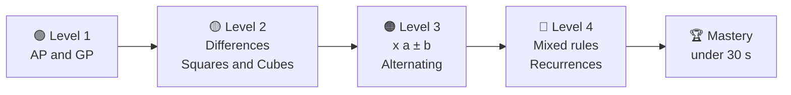
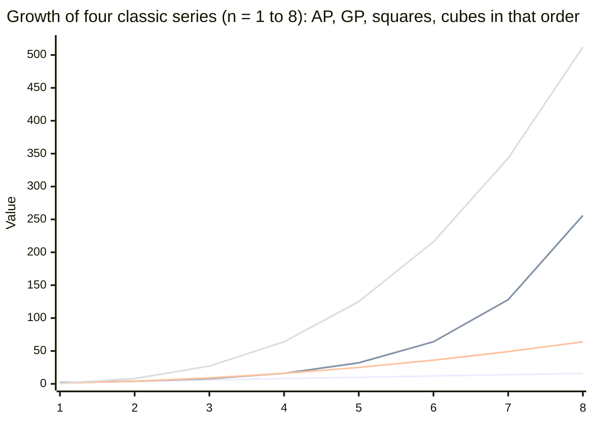
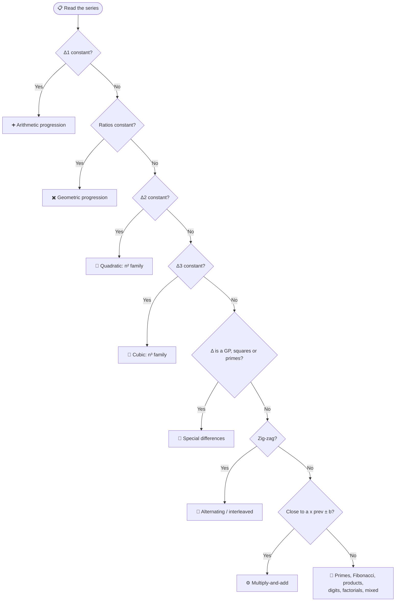
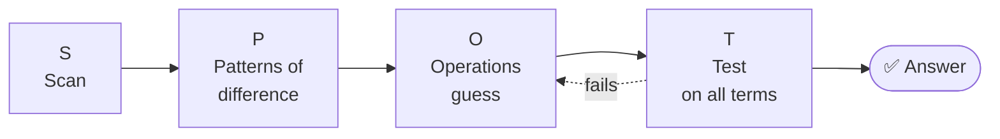
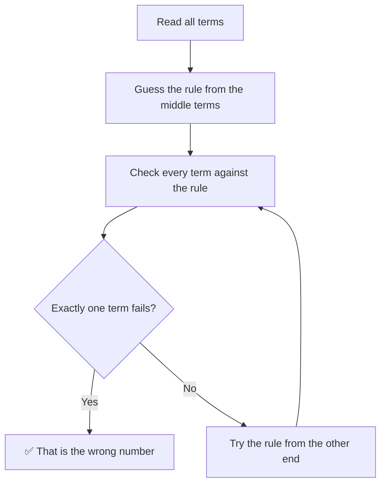
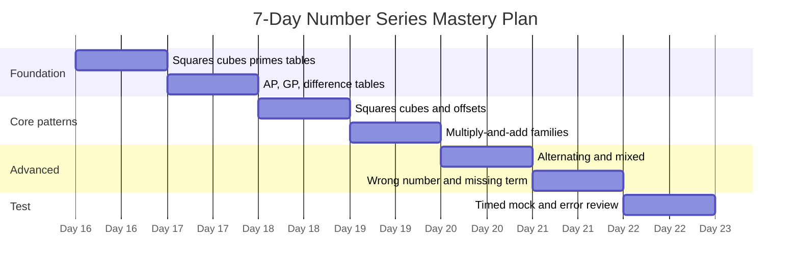
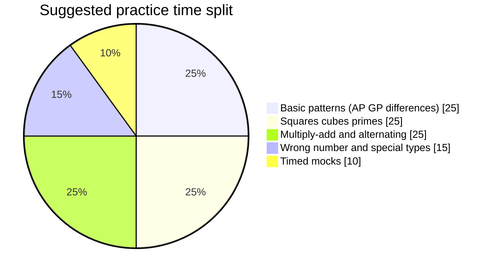
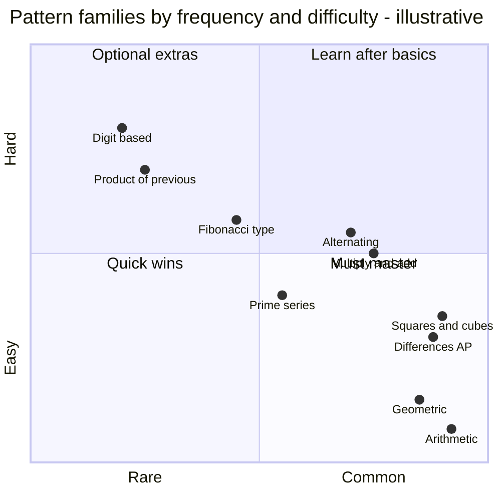

# 🔢 NUMBER SERIES — Complete Notes

> *The art of seeing the rule hidden behind a row of numbers.*

| 🎯 Level | ⏱ Target time / question | 📊 Exam frequency | 🧠 Skill type |
|:---:|:---:|:---:|:---:|
| Easy → Medium | 30–45 seconds | Very high in campus aptitude tests | Pattern recognition + speed |

| 📁 Companion files | What it gives you |
|---|---|
| 📘 `notes.md` *(this file)* | Concepts, every pattern family, worked solutions, strategy |
| 📐 `formulas.md` | Formulas, lookup tables (squares, cubes, primes, factorials…) |
| 🧪 `practice.md` | 150+ graded questions + mock test + answer keys |
| 🐞 `mistakes.md` | Common errors, error log, trackers, drills |

---

## 🗺️ Contents of this file

| Part | Topic | You will learn |
|:---:|---|---|
| 1 | Basics & vocabulary | What a series is and how questions are asked |
| 2 | Growth fingerprints | Guess the pattern from how numbers grow |
| 3 | Difference tables | The most powerful general tool |
| 4 | The SPOT method | A 4-step routine for every question |
| 5 | 19 pattern families | Each with spotting tips + auto-verified examples |
| 6 | Special question types | Wrong number, missing term, pairs, groups |
| 7 | 20 full worked solutions | Step-by-step reasoning |
| 8 | Speed & elimination tricks | Save 10–20 seconds per question |
| 9 | Study plan & self-check | A 7-day mastery roadmap |

---

# 📖 PART 1 — Basics & Vocabulary

## 1.1 What is a number series?

A **number series** is an ordered list of numbers that follows a hidden rule. Your job is to **find the rule** and extend it (or repair it).

```text
   Position :   1    2    3    4    5    6    ?
   Term     :   3    7   15   31   63  127    ?   ← find the rule, find the ?
```

## 1.2 Vocabulary

| Term | Meaning | Example |
|---|---|---|
| Term / element | One number in the series | In `5, 9, 13` the 2nd term is 9 |
| Position `n` | Place of a term (1st, 2nd, …) | n = 3 → third term |
| Common difference `d` | Fixed gap in an AP | `4, 7, 10` → d = 3 |
| Common ratio `r` | Fixed multiplier in a GP | `3, 6, 12` → r = 2 |
| 1st differences | Gaps between neighbours | `2, 5, 10` → 3, 5 |
| 2nd differences | Gaps of the gaps | 3, 5 → 2 |
| Recurrence | Next term from earlier terms | Fibonacci |
| Interleaved series | Two series woven together | `1, 2, 3, 4, 5, 8` |

## 1.3 How questions appear in exams

| # | Format | Example | What you do |
|:-:|---|---|---|
| 1 | **Next term** | `2, 5, 10, 17, ?` | Find the rule, apply once more |
| 2 | **Missing term (middle)** | `3, 7, ?, 31, 63` | Use neighbours on both sides |
| 3 | **Wrong number** | `3, 7, 15, 32, 63` | Spot the term that breaks the rule |
| 4 | **Next two terms** | `1, 4, 9, ?, ?` | Rule gives both |
| 5 | **Pair / group series** | `(2,3,6) (3,4,12) (4,5,?)` | Rule inside each group |
| 6 | **Alphabet-number mixed** | `A1, C3, E5, ?` | Treat letter and number separately |

## 1.4 Skill ladder



---

# 📈 PART 2 — Growth Fingerprints

> 💡 Before computing anything, **look at how fast the numbers grow**. Growth shape is a fingerprint of the rule.



### Visual: squares vs cubes (ASCII bars)

```text
  1² │█ 1
  2² │█ 4
  3² │███ 9
  4² │██████ 16
  5² │█████████ 25
  6² │█████████████ 36
  7² │██████████████████ 49
  8² │███████████████████████ 64
  9² │█████████████████████████████ 81
 10² │████████████████████████████████████ 100
```

```text
  1³ │█ 1
  2³ │█ 8
  3³ │██ 27
  4³ │████ 64
  5³ │█████████ 125
  6³ │███████████████ 216
  7³ │████████████████████████ 343
  8³ │████████████████████████████████████ 512
```

### Fingerprint table

| 🔎 What you observe | 🧩 Likely pattern | Quick test |
|---|---|---|
| Gap stays the same | Arithmetic progression | 1st differences equal |
| Each term is a fixed multiple of the last | Geometric progression | Ratios equal |
| Gaps grow by a fixed amount | Quadratic (n² types) | 2nd differences equal |
| Gaps double / triple | 2ⁿ or 3ⁿ type | Differences form a GP |
| Gaps are 3, 5, 7, 9 … | Perfect squares | Differences are odd numbers |
| Gaps are 2, 3, 5, 7, 11 | Prime-difference series | Compare with prime list |
| Multipliers go ×1, ×2, ×3, ×4 | Factorial-like | Ratios increase by 1 |
| Terms nearly double each step but off by a constant | ×2 ± b | Try ×2+1, ×2−1 |
| Numbers very close to squares/cubes | n² ± k, n³ ± k | Compare with square/cube table |
| Zig-zag: up, down, up, down | Alternating / interleaved | Split odd and even places |
| Growth explodes (ratio itself grows) | n^n, product of previous | Check product rule |

### Ratio behaviour (consecutive-term ratio)

```text
   ratio
    3 │ ■
      │  ■
    2 │   ■ ■ ■ ■ ■ ■ ■ ■ ■    ← constant 2   → Geometric (×2)
      │
  1.5 │      ·  ·  ·  ·  ·       ← slowly falling to 1 → polynomial (n², n³)
      │
    1 └────────────────────────
        t2  t3  t4  t5  t6
```

---

# 🧮 PART 3 — Difference Tables (The Master Tool)

Write the series, then write the differences **below** it. Keep differencing until the row becomes constant.

### Example A — Quadratic (n² type)

```text
  Series :   2    6    12    20    30
  Δ1     :      4     6     8    10
  Δ2     :         2     2     2        ← constant → quadratic
```

### Example B — Cubic (n³ type)

```text
  Series :   1    8    27    64    125
  Δ1     :      7    19    37     61
  Δ2     :         12    18    24
  Δ3     :              6     6          ← constant → cubic
```

### Degree rule

| Row that becomes constant | Degree | Family | Example |
|:---:|:---:|---|---|
| Δ1 | 1 | Linear = AP | 5, 9, 13, 17 |
| Δ2 | 2 | Quadratic | 2, 6, 12, 20 |
| Δ3 | 3 | Cubic | 1, 8, 27, 64 |
| Never (Δ rows grow like a GP) | — | Exponential | 3, 4, 6, 10, 18 |

### Decision flow



---

# 🎯 PART 4 — The SPOT Method

| Letter | Step | What you do | Time |
|:---:|---|---|:---:|
| **S** | **Scan** | Read all terms. Notice size, growth, parity, zig-zag | 3 s |
| **P** | **Patterns of difference** | Write Δ1 and Δ2. Check ratios | 10 s |
| **O** | **Operations guess** | Try ×a ± b, squares, cubes, primes | 10 s |
| **T** | **Test on ALL terms** | The rule must fit every given term, not just two | 7 s |

> ⚠️ **Rule of three:** a rule that explains only two or three terms may be a coincidence. Always test the *whole* row before answering.



### Time budget per question

| Stage | Target | If you exceed it |
|---|:---:|---|
| Identify rule | ≤ 30 s | Move on, mark for review |
| Compute answer | ≤ 10 s | Re-check subtraction |
| Total | ≤ 45 s | Skip; come back if time remains |

---

# 🧠 PART 5 — The 19 Pattern Families

> Every example below is **generated and verified by code**. Study the *spotting tip*, then cover the answer and try each series yourself.

## ➕ Pattern 1 — Arithmetic Progression (AP)

> **Idea:** Add or subtract the same number every time.

**🔍 How to spot it**

- Δ1 is the same everywhere
- Terms form a straight line if plotted
- Easy to confuse with 'increasing differences' — check Δ1 twice

**🛠 Method:** Find `d = t₂ − t₁`, then check `t₃ − t₂`. Next term = last + d.

| # | Series | Next | Δ1 (differences) | Rule |
|:-:|---|:-:|---|---|
| 1 | `26, 30, 34, 38, 42, 46, ?` | **50** | +4, +4, +4, +4, +4 | Arithmetic progression, common difference +4 |
| 2 | `29, 38, 47, 56, 65, 74, ?` | **83** | +9, +9, +9, +9, +9 | Arithmetic progression, common difference +9 |
| 3 | `19, 24, 29, 34, 39, 44, ?` | **49** | +5, +5, +5, +5, +5 | Arithmetic progression, common difference +5 |
| 4 | `51, 48, 45, 42, 39, 36, ?` | **33** | −3, −3, −3, −3, −3 | Arithmetic progression, common difference −3 |
| 5 | `15, 23, 31, 39, 47, 55, ?` | **63** | +8, +8, +8, +8, +8 | Arithmetic progression, common difference +8 |

**Worked look at example 1:** `26, 30, 34, 38, 42, 46, ?`

```text
Series :     26      30      34      38      42      46    ?
Δ1     :              4       4       4       4       4
Δ2     :                    0       0       0       0
Answer : 50
```

---

## ✖️ Pattern 2 — Geometric Progression (GP)

> **Idea:** Multiply (or divide) by the same number every time.

**🔍 How to spot it**

- Terms grow (or shrink) very fast
- Every term divisible by the previous (or vice-versa)
- Ratio `t₂ ÷ t₁` is constant

**🛠 Method:** Find `r = t₂ ÷ t₁`. Next term = last × r.

| # | Series | Next | Δ1 (differences) | Rule |
|:-:|---|:-:|---|---|
| 1 | `4, 12, 36, 108, 324, 972, ?` | **2916** | +8, +24, +72, +216, +648 | Geometric progression, each term ×3 |
| 2 | `3, 15, 75, 375, 1875, ?` | **9375** | +12, +60, +300, +1500 | Geometric progression, each term ×5 |
| 3 | `5, 10, 20, 40, 80, 160, ?` | **320** | +5, +10, +20, +40, +80 | Geometric progression, each term ×2 |
| 4 | `6561, 2187, 729, 243, 81, 27, ?` | **9** | −4374, −1458, −486, −162, −54 | Geometric progression, each term ÷3 |
| 5 | `1, 5, 25, 125, 625, ?` | **3125** | +4, +20, +100, +500 | Geometric progression, each term ×5 |

**Worked look at example 1:** `4, 12, 36, 108, 324, 972, ?`

```text
Series :      4      12      36     108     324     972    ?
Δ1     :              8      24      72     216     648
Δ2     :                   16      48     144     432
Answer : 2916
```

---

## 📶 Pattern 3 — Differences in AP (increasing gaps)

> **Idea:** The gaps themselves form an AP, so the second difference is constant.

**🔍 How to spot it**

- Δ1 changes by the same amount each time
- Δ2 is constant
- Typical shape: 5, 6, 8, 11, 15, 20

**🛠 Method:** Write Δ1, find the step in Δ1, extend Δ1 by one, add to the last term.

| # | Series | Next | Δ1 (differences) | Rule |
|:-:|---|:-:|---|---|
| 1 | `16, 21, 28, 37, 48, 61, ?` | **76** | +5, +7, +9, +11, +13 | Differences form an AP: +5, +7, +9, … (second difference = 2) |
| 2 | `8, 12, 18, 26, 36, 48, ?` | **62** | +4, +6, +8, +10, +12 | Differences form an AP: +4, +6, +8, … (second difference = 2) |
| 3 | `18, 22, 28, 36, 46, 58, ?` | **72** | +4, +6, +8, +10, +12 | Differences form an AP: +4, +6, +8, … (second difference = 2) |
| 4 | `1, 4, 8, 13, 19, 26, ?` | **34** | +3, +4, +5, +6, +7 | Differences form an AP: +3, +4, +5, … (second difference = 1) |
| 5 | `17, 18, 21, 26, 33, 42, ?` | **53** | +1, +3, +5, +7, +9 | Differences form an AP: +1, +3, +5, … (second difference = 2) |

**Worked look at example 1:** `16, 21, 28, 37, 48, 61, ?`

```text
Series :     16      21      28      37      48      61    ?
Δ1     :              5       7       9      11      13
Δ2     :                    2       2       2       2
Answer : 76
```

---

## 📈 Pattern 4 — Differences in GP

> **Idea:** The gaps double (or triple) each time.

**🔍 How to spot it**

- Δ1 = 1, 2, 4, 8 or 2, 6, 18 …
- Often looks like 2ⁿ ± k
- Series grows quickly but not as ×constant

**🛠 Method:** Extend the Δ1 GP by one term, add to the last term.

| # | Series | Next | Δ1 (differences) | Rule |
|:-:|---|:-:|---|---|
| 1 | `12, 14, 18, 26, 42, 74, ?` | **138** | +2, +4, +8, +16, +32 | Differences are 2, 4, 8, … (each difference ×2) |
| 2 | `13, 16, 22, 34, 58, 106, ?` | **202** | +3, +6, +12, +24, +48 | Differences are 3, 6, 12, … (each difference ×2) |
| 3 | `11, 12, 15, 24, 51, ?` | **132** | +1, +3, +9, +27 | Differences are 1, 3, 9, … (each difference ×3) |
| 4 | `14, 15, 17, 21, 29, 45, ?` | **77** | +1, +2, +4, +8, +16 | Differences are 1, 2, 4, … (each difference ×2) |
| 5 | `2, 5, 14, 41, 122, ?` | **365** | +3, +9, +27, +81 | Differences are 3, 9, 27, … (each difference ×3) |

**Worked look at example 1:** `12, 14, 18, 26, 42, 74, ?`

```text
Series :     12      14      18      26      42      74    ?
Δ1     :              2       4       8      16      32
Δ2     :                    2       4       8      16
Answer : 138
```

---

## 🟦 Pattern 5 — Differences are squares

> **Idea:** The gaps are 1², 2², 3², … or a shifted run of squares.

**🔍 How to spot it**

- Δ1 contains 4, 9, 16, 25 …
- Δ2 is odd numbers: 5, 7, 9

**🛠 Method:** Name the squares in Δ1, take the next square, add.

| # | Series | Next | Δ1 (differences) | Rule |
|:-:|---|:-:|---|---|
| 1 | `13, 29, 54, 90, 139, 203, ?` | **284** | +16, +25, +36, +49, +64 | Differences are consecutive squares 4², 5², 6², … |
| 2 | `9, 25, 50, 86, 135, 199, ?` | **280** | +16, +25, +36, +49, +64 | Differences are consecutive squares 4², 5², 6², … |
| 3 | `15, 31, 56, 92, 141, 205, ?` | **286** | +16, +25, +36, +49, +64 | Differences are consecutive squares 4², 5², 6², … |
| 4 | `6, 15, 31, 56, 92, 141, ?` | **205** | +9, +16, +25, +36, +49 | Differences are consecutive squares 3², 4², 5², … |
| 5 | `8, 12, 21, 37, 62, 98, ?` | **147** | +4, +9, +16, +25, +36 | Differences are consecutive squares 2², 3², 4², … |

**Worked look at example 1:** `13, 29, 54, 90, 139, 203, ?`

```text
Series :     13      29      54      90     139     203    ?
Δ1     :             16      25      36      49      64
Δ2     :                    9      11      13      15
Answer : 284
```

---

## 🧊 Pattern 6 — Differences are cubes

> **Idea:** The gaps are cubes such as 8, 27, 64, 125.

**🔍 How to spot it**

- Δ1 contains 8, 27, 64, 125
- Series grows faster than squares

**🛠 Method:** Identify the cubes in Δ1, take the next cube, add.

| # | Series | Next | Δ1 (differences) | Rule |
|:-:|---|:-:|---|---|
| 1 | `1, 9, 36, 100, 225, ?` | **441** | +8, +27, +64, +125 | Differences are consecutive cubes 2³, 3³, 4³, … |
| 2 | `8, 9, 17, 44, 108, ?` | **233** | +1, +8, +27, +64 | Differences are consecutive cubes 1³, 2³, 3³, … |
| 3 | `4, 5, 13, 40, 104, ?` | **229** | +1, +8, +27, +64 | Differences are consecutive cubes 1³, 2³, 3³, … |
| 4 | `9, 10, 18, 45, 109, ?` | **234** | +1, +8, +27, +64 | Differences are consecutive cubes 1³, 2³, 3³, … |
| 5 | `3, 11, 38, 102, 227, ?` | **443** | +8, +27, +64, +125 | Differences are consecutive cubes 2³, 3³, 4³, … |

**Worked look at example 1:** `1, 9, 36, 100, 225, ?`

```text
Series :      1       9      36     100     225    ?
Δ1     :              8      27      64     125
Δ2     :                   19      37      61
Answer : 441
```

---

## 🔢 Pattern 7 — Differences are primes

> **Idea:** The gaps are 2, 3, 5, 7, 11, 13 … in order.

**🔍 How to spot it**

- Δ1 skips composites (no 4, 6, 8, 9)
- Δ1 is irregular but all prime

**🛠 Method:** Write the prime list, continue Δ1 by the next prime.

| # | Series | Next | Δ1 (differences) | Rule |
|:-:|---|:-:|---|---|
| 1 | `10, 12, 15, 20, 27, 38, ?` | **51** | +2, +3, +5, +7, +11 | Differences are consecutive primes 2, 3, 5, … |
| 2 | `5, 8, 13, 20, 31, 44, ?` | **61** | +3, +5, +7, +11, +13 | Differences are consecutive primes 3, 5, 7, … |
| 3 | `4, 7, 12, 19, 30, 43, ?` | **60** | +3, +5, +7, +11, +13 | Differences are consecutive primes 3, 5, 7, … |
| 4 | `11, 13, 16, 21, 28, 39, ?` | **52** | +2, +3, +5, +7, +11 | Differences are consecutive primes 2, 3, 5, … |
| 5 | `9, 12, 17, 24, 35, 48, ?` | **65** | +3, +5, +7, +11, +13 | Differences are consecutive primes 3, 5, 7, … |

**Worked look at example 1:** `10, 12, 15, 20, 27, 38, ?`

```text
Series :     10      12      15      20      27      38    ?
Δ1     :              2       3       5       7      11
Δ2     :                    1       2       2       4
Answer : 51
```

---

## ⬛ Pattern 8 — Squares and shifted squares

> **Idea:** Terms are n² or n² ± k, 2n², or squares of odd numbers.

**🔍 How to spot it**

- Terms close to 4, 9, 16, 25, 36, 49
- Δ1 = odd numbers (3, 5, 7, 9)
- Subtract the nearest square — if the leftover is constant you have it

**🛠 Method:** Match each term with its nearest square, find the constant offset, evaluate the next n.

| # | Series | Next | Δ1 (differences) | Rule |
|:-:|---|:-:|---|---|
| 1 | `81, 121, 169, 225, 289, 361, ?` | **441** | +40, +48, +56, +64, +72 | Squares of consecutive odd numbers |
| 2 | `1, 6, 13, 22, 33, 46, ?` | **61** | +5, +7, +9, +11, +13 | n² − 3 (n starts at 2) |
| 3 | `36, 49, 64, 81, 100, 121, ?` | **144** | +13, +15, +17, +19, +21 | Perfect squares: 6², 7², 8², … |
| 4 | `6, 11, 18, 27, 38, 51, ?` | **66** | +5, +7, +9, +11, +13 | n² + 2 (n starts at 2) |
| 5 | `25, 36, 49, 64, 81, 100, ?` | **121** | +11, +13, +15, +17, +19 | Perfect squares: 5², 6², 7², … |

**Worked look at example 1:** `81, 121, 169, 225, 289, 361, ?`

```text
Series :     81     121     169     225     289     361    ?
Δ1     :             40      48      56      64      72
Δ2     :                    8       8       8       8
Answer : 441
```

---

## 🟫 Pattern 9 — Cubes and shifted cubes

> **Idea:** Terms are n³, n³ ± k, n³ ± n.

**🔍 How to spot it**

- Terms close to 8, 27, 64, 125, 216, 343
- Δ3 constant = 6
- `n³ − n` gives 0, 6, 24, 60, 120, 210

**🛠 Method:** Compare each term with the nearest cube; find the offset; evaluate the next n.

| # | Series | Next | Δ1 (differences) | Rule |
|:-:|---|:-:|---|---|
| 1 | `2, 9, 28, 65, 126, ?` | **217** | +7, +19, +37, +61 | n³ + 1 |
| 2 | `2, 10, 30, 68, 130, ?` | **222** | +8, +20, +38, +62 | n³ + n |
| 3 | `64, 125, 216, 343, 512, ?` | **729** | +61, +91, +127, +169 | Perfect cubes: 4³, 5³, 6³, … |
| 4 | `10, 17, 36, 73, 134, ?` | **225** | +7, +19, +37, +61 | n³ + 9 |
| 5 | `5, 12, 31, 68, 129, ?` | **220** | +7, +19, +37, +61 | n³ + 4 |

**Worked look at example 1:** `2, 9, 28, 65, 126, ?`

```text
Series :      2       9      28      65     126    ?
Δ1     :              7      19      37      61
Δ2     :                   12      18      24
Answer : 217
```

---

## ▭ Pattern 10 — Pronic / n(n+k) series

> **Idea:** Product of two numbers a fixed distance apart: n(n+1), n(n+2), n(n−1).

**🔍 How to spot it**

- Δ1 increases by 2 each time (Δ2 = 2)
- All terms even for n(n+1)
- Terms sit between two squares

**🛠 Method:** Write each term as a product of two close numbers, extend the pair.

| # | Series | Next | Δ1 (differences) | Rule |
|:-:|---|:-:|---|---|
| 1 | `3, 8, 15, 24, 35, 48, ?` | **63** | +5, +7, +9, +11, +13 | n(n+2), starting at n = 1 |
| 2 | `2, 6, 12, 20, 30, 42, ?` | **56** | +4, +6, +8, +10, +12 | n(n−1), starting at n = 2 |
| 3 | `10, 18, 28, 40, 54, 70, ?` | **88** | +8, +10, +12, +14, +16 | n(n+3), starting at n = 2 |
| 4 | `8, 15, 24, 35, 48, 63, ?` | **80** | +7, +9, +11, +13, +15 | n(n+2), starting at n = 2 |
| 5 | `4, 10, 18, 28, 40, 54, ?` | **70** | +6, +8, +10, +12, +14 | n(n+3), starting at n = 1 |

**Worked look at example 1:** `3, 8, 15, 24, 35, 48, ?`

```text
Series :      3       8      15      24      35      48    ?
Δ1     :              5       7       9      11      13
Δ2     :                    2       2       2       2
Answer : 63
```

---

## ⚙️ Pattern 11 — Multiply-then-add (×a ± b)

> **Idea:** Each term = previous × a + b with fixed a and b.

**🔍 How to spot it**

- Terms roughly double or triple
- Δ1 itself follows the same rule
- Test with the *second* pair too — ×2+1 and ×3−1 can agree on the first pair

**🛠 Method:** Use two consecutive pairs to solve `a` and `b`; verify on a third.

| # | Series | Next | Δ1 (differences) | Rule |
|:-:|---|:-:|---|---|
| 1 | `1, 5, 17, 53, 161, ?` | **485** | +4, +12, +36, +108 | ×3 +2 each step |
| 2 | `7, 20, 59, 176, 527, ?` | **1580** | +13, +39, +117, +351 | ×3 −1 each step |
| 3 | `5, 20, 65, 200, 605, ?` | **1820** | +15, +45, +135, +405 | ×3 +5 each step |
| 4 | `4, 11, 32, 95, 284, ?` | **851** | +7, +21, +63, +189 | ×3 −1 each step |
| 5 | `4, 14, 44, 134, 404, ?` | **1214** | +10, +30, +90, +270 | ×3 +2 each step |

**Worked look at example 1:** `1, 5, 17, 53, 161, ?`

```text
Series :      1       5      17      53     161    ?
Δ1     :              4      12      36     108
Δ2     :                    8      24      72
Answer : 485
```

---

## 🪜 Pattern 12 — Changing multiplier (×1, ×2, ×3 …)

> **Idea:** Multiplier (and often the added number) increases each step.

**🔍 How to spot it**

- Ratios not constant, but ratios grow 1, 2, 3 or similar
- Terms jump suddenly
- Look for ×1+1, ×2+2, ×3+3

**🛠 Method:** Compute ratios (approx.), spot the multiplier run, find the added part, extend.

| # | Series | Next | Δ1 (differences) | Rule |
|:-:|---|:-:|---|---|
| 1 | `1, 2, 5, 16, 65, ?` | **326** | +1, +3, +11, +49 | ×1+1, ×2+1, ×3+1, … |
| 2 | `3, 4, 9, 28, 113, ?` | **566** | +1, +5, +19, +85 | ×1+1, ×2+1, ×3+1, … |
| 3 | `3, 4, 10, 33, 136, ?` | **685** | +1, +6, +23, +103 | ×1+1, ×2+2, ×3+3, ×4+4, … |
| 4 | `2, 5, 13, 42, 171, ?` | **858** | +3, +8, +29, +129 | ×1+3, ×2+3, ×3+3, … |
| 5 | `1, 3, 11, 47, 239, ?` | **1439** | +2, +8, +36, +192 | ×2+1, ×3+2, ×4+3, ×5+4, … |

**Worked look at example 1:** `1, 2, 5, 16, 65, ?`

```text
Series :      1       2       5      16      65    ?
Δ1     :              1       3      11      49
Δ2     :                    2       8      38
Answer : 326
```

---

## 🔀 Pattern 13 — Alternating (interleaved) series

> **Idea:** Two different series woven together, odd and even positions.

**🔍 How to spot it**

- Terms go up and down or look unrelated
- Odd places form one clear series
- Even places form another

**🛠 Method:** Circle odd positions and even positions separately; extend whichever series owns the answer slot.

| # | Series | Next | Δ1 (differences) | Rule |
|:-:|---|:-:|---|---|
| 1 | `1, 3, 8, 6, 27, 12, 64, ?` | **24** | +2, +5, −2, +21, −15, +52 | Two interleaved series. Odd positions: 1³, 2³, 3³, … (cubes). Even positions: 3, 6, 12, … (×2) |
| 2 | `4, 1, 8, 3, 12, 9, ?` | **16** | −3, +7, −5, +9, −3 | Two interleaved series. Odd positions: 4, 8, 12, … (+4). Even positions: 1, 3, 9, … (×3) |
| 3 | `8, 1, 27, 4, 64, 9, ?` | **125** | −7, +26, −23, +60, −55 | Two interleaved series. Odd positions: 2³, 3³, 4³, … (cubes). Even positions: 1², 2², 3², … (squares) |
| 4 | `9, 3, 16, 6, 25, 12, 36, ?` | **24** | −6, +13, −10, +19, −13, +24 | Two interleaved series. Odd positions: 3², 4², 5², … (squares). Even positions: 3, 6, 12, … (×2) |
| 5 | `9, 3, 16, 6, 25, 12, ?` | **36** | −6, +13, −10, +19, −13 | Two interleaved series. Odd positions: 3², 4², 5², … (squares). Even positions: 3, 6, 12, … (×2) |

**Worked look at example 1:** `1, 3, 8, 6, 27, 12, 64, ?`

```text
Series :      1       3       8       6      27      12      64    ?
Δ1     :              2       5      -2      21     -15      52
Δ2     :                    3      -7      23     -36      67
Answer : 24
```

---

## 🔁 Pattern 14 — Alternating operations

> **Idea:** The operation switches each step: +a, ×b, +a, ×b …

**🔍 How to spot it**

- Small step then big jump, repeating
- Δ1 alternates between small and large

**🛠 Method:** Find the first two operations, confirm they repeat, apply the correct one next.

| # | Series | Next | Δ1 (differences) | Rule |
|:-:|---|:-:|---|---|
| 1 | `2, 7, 14, 19, 38, 43, ?` | **86** | +5, +7, +5, +19, +5 | Operations alternate: +5, ×2, +5, ×2, … |
| 2 | `4, 7, 14, 17, 34, 37, ?` | **74** | +3, +7, +3, +17, +3 | Operations alternate: +3, ×2, +3, ×2, … |
| 3 | `4, 8, 16, 20, 40, 44, ?` | **88** | +4, +8, +4, +20, +4 | Operations alternate: +4, ×2, +4, ×2, … |
| 4 | `3, 8, 24, 29, 87, 92, ?` | **276** | +5, +16, +5, +58, +5 | Operations alternate: +5, ×3, +5, ×3, … |
| 5 | `1, 5, 15, 19, 57, 61, ?` | **183** | +4, +10, +4, +38, +4 | Operations alternate: +4, ×3, +4, ×3, … |

**Worked look at example 1:** `2, 7, 14, 19, 38, 43, ?`

```text
Series :      2       7      14      19      38      43    ?
Δ1     :              5       7       5      19       5
Δ2     :                    2      -2      14     -14
Answer : 86
```

---

## ⭐ Pattern 15 — Prime-based series

> **Idea:** Primes, primes ± k, prime squares, double primes.

**🔍 How to spot it**

- Terms are prime or near-prime
- Squares of 4, 9, 25, 49, 121, 169
- Remember 2 is prime, 1 is not

**🛠 Method:** List primes in order and match position; apply the offset.

| # | Series | Next | Δ1 (differences) | Rule |
|:-:|---|:-:|---|---|
| 1 | `11, 13, 17, 19, 23, 29, ?` | **31** | +2, +4, +2, +4, +6 | Consecutive prime numbers |
| 2 | `46, 58, 62, 74, 82, 86, ?` | **94** | +12, +4, +12, +8, +4 | Twice each consecutive prime |
| 3 | `22, 26, 34, 38, 46, 58, ?` | **62** | +4, +8, +4, +8, +12 | Twice each consecutive prime |
| 4 | `4, 6, 10, 14, 22, 26, ?` | **34** | +2, +4, +4, +8, +4 | Twice each consecutive prime |
| 5 | `17, 19, 23, 29, 31, 37, ?` | **41** | +2, +4, +6, +2, +6 | Consecutive prime numbers |

**Worked look at example 1:** `11, 13, 17, 19, 23, 29, ?`

```text
Series :     11      13      17      19      23      29    ?
Δ1     :              2       4       2       4       6
Δ2     :                    2      -2       2       2
Answer : 31
```

---

## 🌀 Pattern 16 — Fibonacci-type (sum of previous terms)

> **Idea:** Each term depends on the previous two or three terms.

**🔍 How to spot it**

- Δ1 equals an earlier term
- Growth ratio tends to about 1.6 (two terms)
- Check `t₃ = t₁ + t₂`

**🛠 Method:** Test `tₙ = tₙ₋₁ + tₙ₋₂ (+ k)`; if the growth is slower, test the three-term sum.

| # | Series | Next | Δ1 (differences) | Rule |
|:-:|---|:-:|---|---|
| 1 | `1, 2, 2, 5, 9, 16, 30, ?` | **55** | +1, +0, +3, +4, +7, +14 | Each term = sum of the previous three |
| 2 | `1, 2, 3, 6, 11, 20, 37, ?` | **68** | +1, +1, +3, +5, +9, +17 | Each term = sum of the previous three |
| 3 | `2, 3, 5, 8, 13, 21, ?` | **34** | +1, +2, +3, +5, +8 | Each term = sum of the previous two |
| 4 | `1, 3, 5, 11, 21, 43, ?` | **85** | +2, +2, +6, +10, +22 | Each term = previous + 2 × the one before it |
| 5 | `2, 3, 7, 13, 27, 53, ?` | **107** | +1, +4, +6, +14, +26 | Each term = previous + 2 × the one before it |

**Worked look at example 1:** `1, 2, 2, 5, 9, 16, 30, ?`

```text
Series :      1       2       2       5       9      16      30    ?
Δ1     :              1       0       3       4       7      14
Δ2     :                   -1       3       1       3       7
Answer : 55
```

---

## ✳️ Pattern 17 — Product of previous terms

> **Idea:** Each term is the product of the two before it.

**🔍 How to spot it**

- Terms explode quickly
- Each term is divisible by both earlier terms

**🛠 Method:** Check `t₃ = t₁ × t₂`; then next = last × second-last.

| # | Series | Next | Δ1 (differences) | Rule |
|:-:|---|:-:|---|---|
| 1 | `2, 2, 4, 8, 32, ?` | **256** | +0, +2, +4, +24 | Each term = product of the previous two |
| 2 | `2, 3, 6, 18, 108, ?` | **1944** | +1, +3, +12, +90 | Each term = product of the previous two |
| 3 | `1, 2, 2, 4, 8, ?` | **32** | +1, +0, +2, +4 | Each term = product of the previous two |
| 4 | `1, 3, 3, 9, 27, ?` | **243** | +2, +0, +6, +18 | Each term = product of the previous two |

**Worked look at example 1:** `2, 2, 4, 8, 32, ?`

```text
Series :      2       2       4       8      32    ?
Δ1     :              0       2       4      24
Δ2     :                    2       2      20
Answer : 256
```

---

## 💥 Pattern 18 — Powers and factorials

> **Idea:** Terms like n!, n^n, 2ⁿ ± n, n! ± 1.

**🔍 How to spot it**

- Terms match 1, 2, 6, 24, 120, 720
- Or 1, 4, 27, 256, 3125
- Or 2ⁿ plus/minus the position

**🛠 Method:** Compare with the factorial / power tables in `formulas.md`.

| # | Series | Next | Δ1 (differences) | Rule |
|:-:|---|:-:|---|---|
| 1 | `1, 2, 6, 24, 120, 720, ?` | **5040** | +1, +4, +18, +96, +600 | Factorials: 1!, 2!, 3!, … |
| 2 | `2, 7, 24, 77, 238, ?` | **723** | +5, +17, +53, +161 | 3ⁿ − n |
| 3 | `1, 4, 27, 256, ?` | **3125** | +3, +23, +229 | n^n  (1¹, 2², 3³, 4⁴, …) |
| 4 | `3, 6, 11, 20, 37, 70, ?` | **135** | +3, +5, +9, +17, +33 | 2ⁿ + n |
| 5 | `3, 7, 25, 121, 721, ?` | **5041** | +4, +18, +96, +600 | n! + 1 (n starts at 2) |

**Worked look at example 1:** `1, 2, 6, 24, 120, 720, ?`

```text
Series :      1       2       6      24     120     720    ?
Δ1     :              1       4      18      96     600
Δ2     :                    3      14      78     504
Answer : 5040
```

---

## 🔟 Pattern 19 — Digit-based series

> **Idea:** Rules that use the digits of the previous term.

**🔍 How to spot it**

- Increments vary irregularly
- Δ1 equals the digit sum of the previous term

**🛠 Method:** Compute digit sums of the terms and compare with Δ1.

| # | Series | Next | Δ1 (differences) | Rule |
|:-:|---|:-:|---|---|
| 1 | `1, 2, 4, 8, 16, 23, ?` | **28** | +1, +2, +4, +8, +7 | Add the sum of the digits of the previous term |
| 2 | `3, 6, 12, 15, 21, 24, ?` | **30** | +3, +6, +3, +6, +3 | Add the sum of the digits of the previous term |
| 3 | `2, 4, 8, 16, 23, 28, ?` | **38** | +2, +4, +8, +7, +5 | Add the sum of the digits of the previous term |
| 4 | `5, 10, 11, 13, 17, 25, ?` | **32** | +5, +1, +2, +4, +8 | Add the sum of the digits of the previous term |
| 5 | `7, 14, 19, 29, 40, 44, ?` | **52** | +7, +5, +10, +11, +4 | Add the sum of the digits of the previous term |

**Worked look at example 1:** `1, 2, 4, 8, 16, 23, ?`

```text
Series :      1       2       4       8      16      23    ?
Δ1     :              1       2       4       8       7
Δ2     :                    1       2       4      -1
Answer : 28
```

---

# 🧩 PART 6 — Special Question Types

## 6.1 Wrong-number series 🚫

**Goal:** find the one term that breaks the rule.



| Tip | Why |
|---|---|
| Trust the **middle** terms most | The first or last term is often the corrupted one |
| Check parity | In n²+1 series, a term with wrong parity gives it away |
| Check the size | A term far too big or small stands out |
| Fix the term, then re-test | The corrected series must be perfectly smooth |

**Example:** `3, 7, 15, 31, 63, 126, 255` — rule ×2+1 gives 3, 7, 15, 31, 63, **127**, 255, so **126** is wrong.

## 6.2 Missing term in the middle 🕳️

| Situation | Method |
|---|---|
| `3, 7, ?, 31, 63` | Use both neighbours: ×2+1 forwards from 7 gives 15; check 15 → 31 ✔ |
| `4, 10, ?, 82, 244` | 4→10 ×3−2; 10→28 ; 28→82 ; 82→244 ✔ answer 28 |
| Differences | Fill Δ1 gap using the pattern of Δ1 on both sides |

## 6.3 Pair and group series 👥

| Type | Example | Rule | Answer |
|---|---|---|:-:|
| Product of first two | (2,3,6) (3,4,12) (4,5,?) | a × b = c | **20** |
| Sum of first two | (4,5,9) (6,7,13) (8,9,?) | a + b = c | **17** |
| a² + b | (2,3,7) (3,4,13) (4,5,?) | a² + b | **21** |
| Middle = average | (3,6,9) (5,10,15) (7,14,?) | c = a + b | **21** |
| Row/column | 2 4 8 / 3 9 27 / 4 16 ? | n, n², n³ | **64** |

## 6.4 Letter-number series 🔡

Treat letters as positions (A = 1 … Z = 26). Example `A1, C3, E5, G7, ?` → **I9**.

## 6.5 Fraction and decimal series 🧮

| Series | Rule | Next |
|---|---|:-:|
| `1/2, 2/3, 3/4, 4/5, ?` | n/(n+1) | **5/6** |
| `8, 12, 18, 27, 40.5, ?` | ×1.5 | **60.75** |
| `0.5, 1, 2, 4, ?` | ×2 | **8** |
| `1/2, 1/4, 1/8, ?` | ÷2 | **1/16** |

---

# ✍️ PART 7 — 20 Full Worked Solutions

### ✅ W1. `3, 5, 9, 17, 33, ?`

- 🔎 **Reasoning:** Δ1: 2, 4, 8, 16 → doubles. Next Δ1 = 32.
- 🎯 **Answer:** 33 + 32 = **65**
- 🏷️ **Pattern:** Differences in GP; also 2ⁿ + 1

### ✅ W2. `2, 3, 5, 8, 12, 17, ?`

- 🔎 **Reasoning:** Δ1: 1, 2, 3, 4, 5 → next 6.
- 🎯 **Answer:** 17 + 6 = **23**
- 🏷️ **Pattern:** Differences in AP

### ✅ W3. `1, 2, 6, 24, 120, ?`

- 🔎 **Reasoning:** Ratios: ×2, ×3, ×4, ×5 → next ×6.
- 🎯 **Answer:** 120 × 6 = **720**
- 🏷️ **Pattern:** Factorials

### ✅ W4. `4, 9, 16, 25, 36, ?`

- 🔎 **Reasoning:** Squares of 2, 3, 4, 5, 6 → next 7².
- 🎯 **Answer:** **49**
- 🏷️ **Pattern:** Squares

### ✅ W5. `3, 8, 15, 24, 35, ?`

- 🔎 **Reasoning:** Each is n² − 1 with n = 2, 3, 4, 5, 6 → next 7² − 1.
- 🎯 **Answer:** 49 − 1 = **48**
- 🏷️ **Pattern:** Square minus 1

### ✅ W6. `2, 9, 28, 65, 126, ?`

- 🔎 **Reasoning:** Each is n³ + 1 with n = 1…5 → next 6³ + 1.
- 🎯 **Answer:** 216 + 1 = **217**
- 🏷️ **Pattern:** Cube plus 1

### ✅ W7. `5, 11, 23, 47, 95, ?`

- 🔎 **Reasoning:** 5→11: ×2+1; 11→23: ×2+1; 23→47: ×2+1.
- 🎯 **Answer:** 95 × 2 + 1 = **191**
- 🏷️ **Pattern:** ×2 + 1

### ✅ W8. `1, 4, 27, 16, 125, 36, ?`

- 🔎 **Reasoning:** Odd places: 1³, 3³, 5³ → 7³. Even places: 2², 4², 6².
- 🎯 **Answer:** 7³ = **343**
- 🏷️ **Pattern:** Interleaved cubes and squares

### ✅ W9. `11, 13, 17, 19, 23, 29, 31, ?`

- 🔎 **Reasoning:** Consecutive primes. After 31 comes 37.
- 🎯 **Answer:** **37**
- 🏷️ **Pattern:** Primes

### ✅ W10. `3, 7, 15, 31, 63, 126, 255 (wrong no.)`

- 🔎 **Reasoning:** ×2+1 gives 127 at the 6th place.
- 🎯 **Answer:** Wrong number = **126**
- 🏷️ **Pattern:** Wrong-number type

### ✅ W11. `100, 96, 88, 72, 40, ?`

- 🔎 **Reasoning:** Δ1: −4, −8, −16, −32 → next −64.
- 🎯 **Answer:** 40 − 64 = **−24**
- 🏷️ **Pattern:** Differences in GP (negative)

### ✅ W12. `1, 3, 6, 10, 15, 21, 28, ?`

- 🔎 **Reasoning:** Δ1: 2, 3, 4, 5, 6, 7 → next 8.
- 🎯 **Answer:** 28 + 8 = **36**
- 🏷️ **Pattern:** Triangular numbers

### ✅ W13. `8, 12, 18, 27, 40.5, ?`

- 🔎 **Reasoning:** Ratio 12/8 = 1.5; 18/12 = 1.5; 27/18 = 1.5.
- 🎯 **Answer:** 40.5 × 1.5 = **60.75**
- 🏷️ **Pattern:** Decimal GP

### ✅ W14. `1/2, 2/3, 3/4, 4/5, ?`

- 🔎 **Reasoning:** Numerator n, denominator n+1.
- 🎯 **Answer:** **5/6**
- 🏷️ **Pattern:** Fraction pattern

### ✅ W15. `2, 6, 7, 21, 22, 66, ?`

- 🔎 **Reasoning:** ×3, +1, ×3, +1, ×3 → next +1.
- 🎯 **Answer:** 66 + 1 = **67**
- 🏷️ **Pattern:** Alternating operations

### ✅ W16. `1, 2, 4, 8, 16, 23, 28, 38, 49, ?`

- 🔎 **Reasoning:** Add digit sum: 16+(1+6)=23, 23+5=28, 28+10=38, 38+11=49, 49+13.
- 🎯 **Answer:** 49 + 13 = **62**
- 🏷️ **Pattern:** Digit-based

### ✅ W17. `1, 10, 100, 2, 20, 200, 3, 30, ?`

- 🔎 **Reasoning:** Groups of three: (n, 10n, 100n).
- 🎯 **Answer:** **300**
- 🏷️ **Pattern:** Group pattern

### ✅ W18. `0, 1, 1, 2, 4, 7, 13, 24, ?`

- 🔎 **Reasoning:** Each = sum of previous three: 7+13+24.
- 🎯 **Answer:** **44**
- 🏷️ **Pattern:** Tribonacci

### ✅ W19. `2, 3, 6, 18, 108, ?`

- 🔎 **Reasoning:** Product of previous two: 18 × 6 = 108 ✔; 108 × 18.
- 🎯 **Answer:** **1944**
- 🏷️ **Pattern:** Product of previous two

### ✅ W20. `6, 11, 21, 36, 56, ?`

- 🔎 **Reasoning:** Δ1: 5, 10, 15, 20 → next 25.
- 🎯 **Answer:** 56 + 25 = **81**
- 🏷️ **Pattern:** Differences multiples of 5

---

# ⚡ PART 8 — Speed & Elimination Tricks

## 8.1 Last-digit tricks

| Fact | Use |
|---|---|
| Squares end only in 0, 1, 4, 5, 6, 9 | Option ending in 2, 3, 7, 8 cannot be a perfect square |
| Cubes: last digit of n³ matches n → 1→1, 2→8, 3→7, 4→4, 5→5, 6→6, 7→3, 8→2, 9→9 | Quick check of cube answers |
| Prime > 5 never ends in 0, 2, 4, 5, 6, 8 | Eliminate prime options fast |
| Odd + odd = even | Parity pattern predicts the parity of the answer |

## 8.2 Parity pattern

```text
  Series  : 3   7   15  31  63  ?
  Parity  : O   O   O   O   O   → answer must be odd
```

## 8.3 Magnitude check

| Observation | Meaning |
|---|---|
| Last Δ was 20, series is accelerating | Answer ≈ last + 25 or more |
| Terms doubling | Answer ≈ 2 × last (± small) |
| Option far outside the expected range | Eliminate |

## 8.4 When two rules seem to fit

> Prefer the **simplest** rule that fits **every** term; if options distinguish the two, the options decide.

`1, 2, 4, ?` → 7 (differences +1,+2,+3) or 8 (×2). With more terms `1, 2, 4, 8, 16` the ×2 rule is the only one that survives.

## 8.5 Memorise these 12 numbers cold

| Set | Values |
|---|---|
| Squares 1–20 | 1, 4, 9, 16, 25, 36, 49, 64, 81, 100, 121, 144, 169, 196, 225, 256, 289, 324, 361, 400 |
| Cubes 1–10 | 1, 8, 27, 64, 125, 216, 343, 512, 729, 1000 |
| Primes below 50 | 2, 3, 5, 7, 11, 13, 17, 19, 23, 29, 31, 37, 41, 43, 47 |
| Factorials | 1, 2, 6, 24, 120, 720, 5040 |
| Powers of 2 | 2, 4, 8, 16, 32, 64, 128, 256, 512, 1024 |

---

# 🗓️ PART 9 — Study Plan & Self-Check







## ✅ Final self-check before you mark an answer

- [ ] Does my rule fit **every** given term?
- [ ] Did I compute Δ1 **and** Δ2?
- [ ] Did I consider alternating patterns?
- [ ] Is my arithmetic right (sign, carrying)?
- [ ] Does the answer appear in the options? If not, re-think the rule.

## 🏁 One-page cheat card

```text
┌────────────────────────────────────────────────────────────┐
│  SPOT : Scan → Patterns of difference → Operations → Test  │
│  Δ1 const → AP     ratio const → GP     Δ2 const → n²      │
│  Δ3 const → n³     Δ GP → 2ⁿ type       zig-zag → split    │
│  ×a±b  → test two pairs    ratios 1,2,3 → factorial type   │
│  Know: squares to 20, cubes to 10, primes to 50, 2ⁿ, n!    │
└────────────────────────────────────────────────────────────┘
```

➡️ Next: open `formulas.md` for the reference tables, then attack `practice.md`, and log slips in `mistakes.md`.