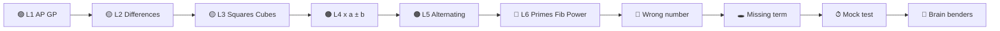
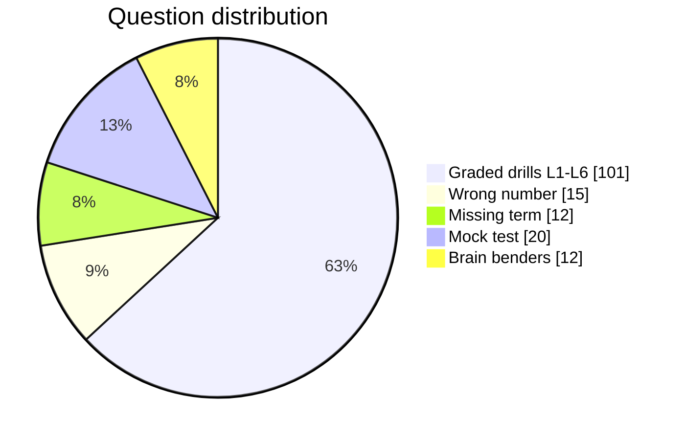

# 🧪 NUMBER SERIES — Practice Set

> *Pattern recognition is a muscle. Train it with volume, then with speed.*

| 📦 Contents | Count |
|---|:-:|
| Level 1–6 graded drills | 101 |
| Wrong-number questions | 15 |
| Missing-term questions | 12 |
| Timed mock test | 20 |
| Brain benders (open answer) | 12 |
| **Total** | **160** |

## 📋 How to use this file

1. Attempt a level **without** looking at the key.
2. Time yourself. Target ≤ 45 s per question.
3. Mark answers on paper; then open the key.
4. For every miss, write the reason in `mistakes.md` with its tag.
5. Re-attempt missed questions after 48 hours.

## 🎯 Scoring & Pacing

| Accuracy | Verdict | Action |
|:-:|---|---|
| ≥ 90 % | 🏆 Mastered | Move to next level, increase speed |
| 75–89 % | 👍 Solid | Review errors, retry in 2 days |
| 60–74 % | ⚠️ Shaky | Re-read the matching pattern in `notes.md` |
| < 60 % | 🔴 Weak | Revise basics, redo level tomorrow |

```text
  Pacing guide (per question)
  Level 1  │██████          20 s
  Level 2  │█████████       30 s
  Level 3  │█████████       30 s
  Level 4  │████████████    40 s
  Level 5  │████████████    40 s
  Level 6  │███████████████ 50 s
```





## 📈 Progress tracker

| Level | Date | Score | Time taken | Accuracy | Status |
|---|---|:-:|:-:|:-:|:-:|
| L1 | | /15 | | | ⬜ |
| L2 | | /18 | | | ⬜ |
| L3 | | /18 | | | ⬜ |
| L4 | | /15 | | | ⬜ |
| L5 | | /15 | | | ⬜ |
| L6 | | /20 | | | ⬜ |
| Wrong number | | /15 | | | ⬜ |
| Missing term | | /12 | | | ⬜ |
| Mock | | /20 | | | ⬜ |
| Benders | | /12 | | | ⬜ |

---

# 📚 SECTION A — Graded Drills

## 🟢 Level 1 — AP and GP

> Add, subtract, multiply or divide by a constant.

⏱ **Suggested time:** 6 minutes   |   ✍️ **Mark your answers, then open the key.**

**Q1** 🟢 `77, 71, 65, 59, 53, 47, ?`
> **A)** 41  **B)** 40  **C)** 43  **D)** 42

**Q2** 🟢 `64, 58, 52, 46, 40, 34, ?`
> **A)** 27  **B)** 29  **C)** 30  **D)** 28

**Q3** 🟢 `101, 92, 83, 74, 65, 56, ?`
> **A)** 46  **B)** 47  **C)** 49  **D)** 48

**Q4** 🟢 `7, 16, 25, 34, 43, 52, ?`
> **A)** 60  **B)** 63  **C)** 61  **D)** 62

**Q5** 🟢 `89, 80, 71, 62, 53, 44, ?`
> **A)** 35  **B)** 36  **C)** 37  **D)** 34

**Q6** 🟢 `5, 13, 21, 29, 37, 45, ?`
> **A)** 54  **B)** 55  **C)** 52  **D)** 53

**Q7** 🟢 `59, 53, 47, 41, 35, 29, ?`
> **A)** 23  **B)** 24  **C)** 25  **D)** 22

**Q8** 🟢 `4, 11, 18, 25, 32, 39, ?`
> **A)** 46  **B)** 47  **C)** 45  **D)** 48

**Q9** 🟢 `4, 16, 64, 256, 1024, ?`
> **A)** 4097  **B)** 4095  **C)** 1792  **D)** 4096

**Q10** 🟢 `5, 10, 20, 40, 80, 160, ?`
> **A)** 320  **B)** 240  **C)** 321  **D)** 319

**Q11** 🟢 `13122, 4374, 1458, 486, 162, 54, ?`
> **A)** 18  **B)** 19  **C)** 17  **D)** 20

**Q12** 🟢 `1, 2, 4, 8, 16, 32, ?`
> **A)** 65  **B)** 63  **C)** 48  **D)** 64

**Q13** 🟢 `1, 5, 25, 125, 625, ?`
> **A)** 3125  **B)** 1125  **C)** 3124  **D)** 3126

**Q14** 🟢 `3, 15, 75, 375, 1875, ?`
> **A)** 9374  **B)** 9376  **C)** 9375  **D)** 3375

**Q15** 🟢 `6, 30, 150, 750, 3750, ?`
> **A)** 18751  **B)** 18749  **C)** 6750  **D)** 18750

<details><summary>🔑 Answer key — Q1 to Q15</summary>

| Q | Ans | Value | Explanation |
|:-:|:-:|:-:|---|
| 1 | **A** | 41 | Arithmetic progression, common difference −6 |
| 2 | **D** | 28 | Arithmetic progression, common difference −6 |
| 3 | **B** | 47 | Arithmetic progression, common difference −9 |
| 4 | **C** | 61 | Arithmetic progression, common difference +9 |
| 5 | **A** | 35 | Arithmetic progression, common difference −9 |
| 6 | **D** | 53 | Arithmetic progression, common difference +8 |
| 7 | **A** | 23 | Arithmetic progression, common difference −6 |
| 8 | **A** | 46 | Arithmetic progression, common difference +7 |
| 9 | **D** | 4096 | Geometric progression, each term ×4 |
| 10 | **A** | 320 | Geometric progression, each term ×2 |
| 11 | **A** | 18 | Geometric progression, each term ÷3 |
| 12 | **D** | 64 | Geometric progression, each term ×2 |
| 13 | **A** | 3125 | Geometric progression, each term ×5 |
| 14 | **C** | 9375 | Geometric progression, each term ×5 |
| 15 | **D** | 18750 | Geometric progression, each term ×5 |

</details>

---

## 🟡 Level 2 — Differences

> Write Δ1 (and Δ2). The gaps are APs, GPs, squares, cubes or primes.

⏱ **Suggested time:** 10 minutes   |   ✍️ **Mark your answers, then open the key.**

**Q16** 🟡 `5, 7, 10, 14, 19, 25, ?`
> **A)** 33  **B)** 32  **C)** 34  **D)** 31

**Q17** 🟡 `20, 24, 29, 35, 42, 50, ?`
> **A)** 58  **B)** 59  **C)** 60  **D)** 61

**Q18** 🟡 `4, 7, 11, 16, 22, 29, ?`
> **A)** 37  **B)** 39  **C)** 36  **D)** 38

**Q19** 🟡 `8, 11, 15, 20, 26, 33, ?`
> **A)** 41  **B)** 42  **C)** 43  **D)** 40

**Q20** 🟡 `11, 16, 22, 29, 37, 46, ?`
> **A)** 56  **B)** 55  **C)** 57  **D)** 58

**Q21** 🟡 `18, 22, 29, 39, 52, 68, ?`
> **A)** 86  **B)** 84  **C)** 88  **D)** 87

**Q22** 🟡 `11, 13, 19, 37, 91, ?`
> **A)** 145  **B)** 254  **C)** 253  **D)** 252

**Q23** 🟡 `7, 10, 16, 28, 52, 100, ?`
> **A)** 195  **B)** 148  **C)** 197  **D)** 196

**Q24** 🟡 `9, 10, 13, 22, 49, ?`
> **A)** 76  **B)** 131  **C)** 130  **D)** 129

**Q25** 🟡 `15, 16, 19, 28, 55, ?`
> **A)** 137  **B)** 82  **C)** 135  **D)** 136

**Q26** 🟡 `10, 19, 35, 60, 96, 145, ?`
> **A)** 209  **B)** 210  **C)** 194  **D)** 208

**Q27** 🟡 `13, 29, 54, 90, 139, 203, ?`
> **A)** 285  **B)** 283  **C)** 267  **D)** 284

**Q28** 🟡 `2, 18, 43, 79, 128, 192, ?`
> **A)** 272  **B)** 256  **C)** 273  **D)** 274

**Q29** 🟡 `8, 9, 13, 22, 38, 63, ?`
> **A)** 98  **B)** 99  **C)** 100  **D)** 88

**Q30** 🟡 `1, 4, 9, 16, 27, 40, ?`
> **A)** 53  **B)** 56  **C)** 57  **D)** 58

**Q31** 🟡 `6, 13, 24, 37, 54, 73, ?`
> **A)** 95  **B)** 92  **C)** 96  **D)** 97

**Q32** 🟡 `9, 10, 18, 45, 109, ?`
> **A)** 235  **B)** 233  **C)** 234  **D)** 173

**Q33** 🟡 `4, 5, 13, 40, 104, ?`
> **A)** 230  **B)** 228  **C)** 168  **D)** 229

<details><summary>🔑 Answer key — Q16 to Q33</summary>

| Q | Ans | Value | Explanation |
|:-:|:-:|:-:|---|
| 16 | **B** | 32 | Differences form an AP: +2, +3, +4, … (second difference = 1) |
| 17 | **B** | 59 | Differences form an AP: +4, +5, +6, … (second difference = 1) |
| 18 | **A** | 37 | Differences form an AP: +3, +4, +5, … (second difference = 1) |
| 19 | **A** | 41 | Differences form an AP: +3, +4, +5, … (second difference = 1) |
| 20 | **A** | 56 | Differences form an AP: +5, +6, +7, … (second difference = 1) |
| 21 | **D** | 87 | Differences form an AP: +4, +7, +10, … (second difference = 3) |
| 22 | **C** | 253 | Differences are 2, 6, 18, … (each difference ×3) |
| 23 | **D** | 196 | Differences are 3, 6, 12, … (each difference ×2) |
| 24 | **C** | 130 | Differences are 1, 3, 9, … (each difference ×3) |
| 25 | **D** | 136 | Differences are 1, 3, 9, … (each difference ×3) |
| 26 | **A** | 209 | Differences are consecutive squares 3², 4², 5², … |
| 27 | **D** | 284 | Differences are consecutive squares 4², 5², 6², … |
| 28 | **C** | 273 | Differences are consecutive squares 4², 5², 6², … |
| 29 | **B** | 99 | Differences are consecutive squares 1², 2², 3², … |
| 30 | **C** | 57 | Differences are consecutive primes 3, 5, 7, … |
| 31 | **C** | 96 | Differences are consecutive primes 7, 11, 13, … |
| 32 | **C** | 234 | Differences are consecutive cubes 1³, 2³, 3³, … |
| 33 | **D** | 229 | Differences are consecutive cubes 1³, 2³, 3³, … |

</details>

---

## 🟡 Level 3 — Squares, Cubes, n(n+k)

> Compare each term with the nearest square or cube.

⏱ **Suggested time:** 10 minutes   |   ✍️ **Mark your answers, then open the key.**

**Q34** 🟡 `25, 49, 81, 121, 169, 225, ?`
> **A)** 281  **B)** 288  **C)** 290  **D)** 289

**Q35** 🟡 `9, 12, 17, 24, 33, 44, ?`
> **A)** 57  **B)** 56  **C)** 55  **D)** 58

**Q36** 🟡 `121, 169, 225, 289, 361, 441, ?`
> **A)** 529  **B)** 521  **C)** 530  **D)** 528

**Q37** 🟡 `6, 13, 22, 33, 46, 61, ?`
> **A)** 78  **B)** 79  **C)** 77  **D)** 76

**Q38** 🟡 `2, 8, 18, 32, 50, 72, ?`
> **A)** 98  **B)** 99  **C)** 97  **D)** 94

**Q39** 🟡 `9, 16, 25, 36, 49, 64, ?`
> **A)** 79  **B)** 81  **C)** 80  **D)** 82

**Q40** 🟡 `81, 121, 169, 225, 289, 361, ?`
> **A)** 441  **B)** 442  **C)** 433  **D)** 440

**Q41** 🟡 `36, 49, 64, 81, 100, 121, ?`
> **A)** 142  **B)** 145  **C)** 144  **D)** 143

**Q42** 🟡 `2, 10, 30, 68, 130, ?`
> **A)** 221  **B)** 222  **C)** 192  **D)** 223

**Q43** 🟡 `3, 10, 29, 66, 127, ?`
> **A)** 188  **B)** 219  **C)** 217  **D)** 218

**Q44** 🟡 `27, 64, 125, 216, 343, ?`
> **A)** 470  **B)** 513  **C)** 512  **D)** 511

**Q45** 🟡 `6, 24, 60, 120, 210, ?`
> **A)** 336  **B)** 300  **C)** 337  **D)** 335

**Q46** 🟡 `1, 8, 27, 64, 125, ?`
> **A)** 216  **B)** 215  **C)** 217  **D)** 186

**Q47** 🟡 `6, 25, 62, 123, 214, ?`
> **A)** 340  **B)** 305  **C)** 342  **D)** 341

**Q48** 🟡 `4, 12, 24, 40, 60, 84, ?`
> **A)** 108  **B)** 111  **C)** 112  **D)** 113

**Q49** 🟡 `12, 20, 30, 42, 56, 72, ?`
> **A)** 91  **B)** 90  **C)** 89  **D)** 88

**Q50** 🟡 `12, 24, 40, 60, 84, 112, ?`
> **A)** 140  **B)** 144  **C)** 145  **D)** 143

**Q51** 🟡 `24, 36, 50, 66, 84, 104, ?`
> **A)** 124  **B)** 127  **C)** 125  **D)** 126

<details><summary>🔑 Answer key — Q34 to Q51</summary>

| Q | Ans | Value | Explanation |
|:-:|:-:|:-:|---|
| 34 | **D** | 289 | Squares of consecutive odd numbers |
| 35 | **A** | 57 | n² + 8 (n starts at 1) |
| 36 | **A** | 529 | Squares of consecutive odd numbers |
| 37 | **A** | 78 | n² − 3 (n starts at 3) |
| 38 | **A** | 98 | 2n² (n = 1, 2, 3, …) |
| 39 | **B** | 81 | Perfect squares: 3², 4², 5², … |
| 40 | **A** | 441 | Squares of consecutive odd numbers |
| 41 | **C** | 144 | Perfect squares: 6², 7², 8², … |
| 42 | **B** | 222 | n³ + n |
| 43 | **D** | 218 | n³ + 2 |
| 44 | **C** | 512 | Perfect cubes: 3³, 4³, 5³, … |
| 45 | **A** | 336 | n³ − n  =  (n−1)·n·(n+1) |
| 46 | **A** | 216 | Perfect cubes: 1³, 2³, 3³, … |
| 47 | **D** | 341 | n³ − 2 (n starts at 2) |
| 48 | **C** | 112 | 2n(n+1), starting at n = 1 |
| 49 | **B** | 90 | n(n+1), starting at n = 3 |
| 50 | **B** | 144 | 2n(n+1), starting at n = 2 |
| 51 | **D** | 126 | n(n+5), starting at n = 3 |

</details>

---

## 🟠 Level 4 — Multiply and Add

> Test ×a ± b on **two** pairs, or look for a growing multiplier.

⏱ **Suggested time:** 10 minutes   |   ✍️ **Mark your answers, then open the key.**

**Q52** 🟠 `5, 13, 37, 109, 325, ?`
> **A)** 973  **B)** 972  **C)** 974  **D)** 541

**Q53** 🟠 `3, 10, 31, 94, 283, ?`
> **A)** 850  **B)** 851  **C)** 849  **D)** 472

**Q54** 🟠 `1, 3, 7, 15, 31, 63, ?`
> **A)** 127  **B)** 126  **C)** 128  **D)** 95

**Q55** 🟠 `4, 13, 49, 193, 769, ?`
> **A)** 3073  **B)** 3072  **C)** 3074  **D)** 1345

**Q56** 🟠 `4, 10, 22, 46, 94, 190, ?`
> **A)** 382  **B)** 381  **C)** 286  **D)** 383

**Q57** 🟠 `3, 16, 68, 276, 1108, ?`
> **A)** 4437  **B)** 1940  **C)** 4436  **D)** 4435

**Q58** 🟠 `6, 16, 46, 136, 406, ?`
> **A)** 1215  **B)** 1217  **C)** 1216  **D)** 676

**Q59** 🟠 `4, 11, 32, 95, 284, ?`
> **A)** 851  **B)** 852  **C)** 850  **D)** 473

**Q60** 🟠 `8, 30, 118, 470, 1878, ?`
> **A)** 3286  **B)** 7510  **C)** 7511  **D)** 7509

**Q61** 🟠 `1, 3, 11, 47, 239, ?`
> **A)** 1440  **B)** 431  **C)** 1439  **D)** 1438

**Q62** 🟠 `4, 5, 12, 39, 160, ?`
> **A)** 804  **B)** 806  **C)** 281  **D)** 805

**Q63** 🟠 `3, 6, 15, 48, 195, ?`
> **A)** 979  **B)** 978  **C)** 342  **D)** 977

**Q64** 🟠 `3, 4, 10, 33, 136, ?`
> **A)** 684  **B)** 685  **C)** 686  **D)** 239

**Q65** 🟠 `1, 2, 6, 21, 88, ?`
> **A)** 446  **B)** 444  **C)** 155  **D)** 445

**Q66** 🟠 `2, 5, 17, 71, 359, ?`
> **A)** 2159  **B)** 647  **C)** 2158  **D)** 2160

<details><summary>🔑 Answer key — Q52 to Q66</summary>

| Q | Ans | Value | Explanation |
|:-:|:-:|:-:|---|
| 52 | **A** | 973 | ×3 −2 each step |
| 53 | **A** | 850 | ×3 +1 each step |
| 54 | **A** | 127 | ×2 +1 each step |
| 55 | **A** | 3073 | ×4 −3 each step |
| 56 | **A** | 382 | ×2 +2 each step |
| 57 | **C** | 4436 | ×4 +4 each step |
| 58 | **C** | 1216 | ×3 −2 each step |
| 59 | **A** | 851 | ×3 −1 each step |
| 60 | **B** | 7510 | ×4 −2 each step |
| 61 | **C** | 1439 | ×2+1, ×3+2, ×4+3, ×5+4, … |
| 62 | **D** | 805 | ×1+1, ×2+2, ×3+3, ×4+4, … |
| 63 | **B** | 978 | ×1+3, ×2+3, ×3+3, … |
| 64 | **B** | 685 | ×1+1, ×2+2, ×3+3, ×4+4, … |
| 65 | **D** | 445 | ×1+1, ×2+2, ×3+3, ×4+4, … |
| 66 | **A** | 2159 | ×2+1, ×3+2, ×4+3, ×5+4, … |

</details>

---

## 🟠 Level 5 — Alternating

> Split odd and even positions, or look for alternating operations.

⏱ **Suggested time:** 10 minutes   |   ✍️ **Mark your answers, then open the key.**

**Q67** 🟠 `3, 1, 7, 8, 11, 27, ?`
> **A)** 14  **B)** 43  **C)** 15  **D)** 16

**Q68** 🟠 `4, 12, 9, 17, 16, 22, 25, ?`
> **A)** 29  **B)** 28  **C)** 26  **D)** 27

**Q69** 🟠 `8, 4, 27, 9, 64, 16, 125, ?`
> **A)** 26  **B)** 234  **C)** 24  **D)** 25

**Q70** 🟠 `5, 1, 7, 4, 9, 9, ?`
> **A)** 11  **B)** 12  **C)** 9  **D)** 10

**Q71** 🟠 `1, 7, 8, 10, 27, 13, ?`
> **A)** 65  **B)** 64  **C)** 63  **D)** 66

**Q72** 🟠 `1, 4, 8, 9, 27, 14, ?`
> **A)** 63  **B)** 64  **C)** 1  **D)** 65

**Q73** 🟠 `1, 1, 4, 3, 9, 9, 16, ?`
> **A)** 23  **B)** 26  **C)** 28  **D)** 27

**Q74** 🟠 `9, 1, 16, 2, 25, 4, 36, ?`
> **A)** 8  **B)** 9  **C)** 324  **D)** 68

**Q75** 🟠 `1, 9, 3, 12, 9, 15, 27, ?`
> **A)** 18  **B)** 19  **C)** 39  **D)** 17

**Q76** 🟠 `4, 6, 18, 20, 60, 62, ?`
> **A)** 64  **B)** 186  **C)** 187  **D)** 185

**Q77** 🟠 `3, 7, 14, 18, 36, 40, ?`
> **A)** 44  **B)** 79  **C)** 81  **D)** 80

**Q78** 🟠 `3, 4, 8, 9, 18, 19, ?`
> **A)** 38  **B)** 20  **C)** 37  **D)** 39

**Q79** 🟠 `3, 7, 21, 25, 75, 79, ?`
> **A)** 237  **B)** 83  **C)** 236  **D)** 238

**Q80** 🟠 `1, 6, 12, 17, 34, 39, ?`
> **A)** 44  **B)** 78  **C)** 79  **D)** 77

**Q81** 🟠 `4, 7, 14, 17, 34, 37, ?`
> **A)** 75  **B)** 74  **C)** 73  **D)** 40

<details><summary>🔑 Answer key — Q67 to Q81</summary>

| Q | Ans | Value | Explanation |
|:-:|:-:|:-:|---|
| 67 | **C** | 15 | Two interleaved series. Odd positions: 3, 7, 11, … (+4). Even positions: 1³, 2³, 3³, … (cubes) |
| 68 | **D** | 27 | Two interleaved series. Odd positions: 2², 3², 4², … (squares). Even positions: 12, 17, 22, … (+5) |
| 69 | **D** | 25 | Two interleaved series. Odd positions: 2³, 3³, 4³, … (cubes). Even positions: 2², 3², 4², … (squares) |
| 70 | **A** | 11 | Two interleaved series. Odd positions: 5, 7, 9, … (+2). Even positions: 1², 2², 3², … (squares) |
| 71 | **B** | 64 | Two interleaved series. Odd positions: 1³, 2³, 3³, … (cubes). Even positions: 7, 10, 13, … (+3) |
| 72 | **B** | 64 | Two interleaved series. Odd positions: 1³, 2³, 3³, … (cubes). Even positions: 4, 9, 14, … (+5) |
| 73 | **D** | 27 | Two interleaved series. Odd positions: 1², 2², 3², … (squares). Even positions: 1, 3, 9, … (×3) |
| 74 | **A** | 8 | Two interleaved series. Odd positions: 3², 4², 5², … (squares). Even positions: 1, 2, 4, … (×2) |
| 75 | **A** | 18 | Two interleaved series. Odd positions: 1, 3, 9, … (×3). Even positions: 9, 12, 15, … (+3) |
| 76 | **B** | 186 | Operations alternate: +2, ×3, +2, ×3, … |
| 77 | **D** | 80 | Operations alternate: +4, ×2, +4, ×2, … |
| 78 | **A** | 38 | Operations alternate: +1, ×2, +1, ×2, … |
| 79 | **A** | 237 | Operations alternate: +4, ×3, +4, ×3, … |
| 80 | **B** | 78 | Operations alternate: +5, ×2, +5, ×2, … |
| 81 | **B** | 74 | Operations alternate: +3, ×2, +3, ×2, … |

</details>

---

## 🔴 Level 6 — Primes, Fibonacci, Powers, Digits

> Mixed advanced families.

⏱ **Suggested time:** 15 minutes   |   ✍️ **Mark your answers, then open the key.**

**Q82** 🔴 `11, 13, 17, 19, 23, 29, ?`
> **A)** 32  **B)** 35  **C)** 30  **D)** 31

**Q83** 🔴 `14, 22, 26, 34, 38, 46, ?`
> **A)** 58  **B)** 59  **C)** 57  **D)** 54

**Q84** 🔴 `22, 26, 34, 38, 46, 58, ?`
> **A)** 70  **B)** 61  **C)** 62  **D)** 63

**Q85** 🔴 `4, 9, 25, 49, 121, ?`
> **A)** 170  **B)** 169  **C)** 168  **D)** 193

**Q86** 🔴 `10, 14, 22, 26, 34, 38, ?`
> **A)** 45  **B)** 47  **C)** 42  **D)** 46

**Q87** 🔴 `1, 1, 2, 3, 5, 8, ?`
> **A)** 14  **B)** 13  **C)** 11  **D)** 12

**Q88** 🔴 `2, 3, 6, 10, 17, 28, ?`
> **A)** 39  **B)** 47  **C)** 46  **D)** 45

**Q89** 🔴 `2, 3, 7, 13, 27, 53, ?`
> **A)** 106  **B)** 108  **C)** 79  **D)** 107

**Q90** 🔴 `1, 2, 2, 5, 9, 16, 30, ?`
> **A)** 55  **B)** 54  **C)** 56  **D)** 44

**Q91** 🔴 `1, 2, 3, 6, 11, 20, 37, ?`
> **A)** 69  **B)** 68  **C)** 67  **D)** 54

**Q92** 🔴 `1, 3, 3, 9, 27, ?`
> **A)** 244  **B)** 81  **C)** 45  **D)** 243

**Q93** 🔴 `2, 2, 4, 8, 32, ?`
> **A)** 256  **B)** 128  **C)** 257  **D)** 56

**Q94** 🔴 `1, 2, 5, 12, 27, 58, ?`
> **A)** 121  **B)** 89  **C)** 122  **D)** 120

**Q95** 🔴 `1, 2, 6, 24, 120, 720, ?`
> **A)** 1320  **B)** 5040  **C)** 4320  **D)** 5041

**Q96** 🔴 `2, 7, 24, 77, 238, ?`
> **A)** 722  **B)** 399  **C)** 724  **D)** 723

**Q97** 🔴 `3, 6, 11, 20, 37, 70, ?`
> **A)** 103  **B)** 135  **C)** 134  **D)** 136

**Q98** 🔴 `1, 4, 27, 256, ?`
> **A)** 3125  **B)** 3126  **C)** 485  **D)** 3124

**Q99** 🔴 `1, 2, 4, 8, 16, 23, ?`
> **A)** 29  **B)** 27  **C)** 28  **D)** 30

**Q100** 🔴 `3, 6, 12, 15, 21, 24, ?`
> **A)** 30  **B)** 27  **C)** 29  **D)** 31

**Q101** 🔴 `5, 10, 11, 13, 17, 25, ?`
> **A)** 31  **B)** 34  **C)** 33  **D)** 32

<details><summary>🔑 Answer key — Q82 to Q101</summary>

| Q | Ans | Value | Explanation |
|:-:|:-:|:-:|---|
| 82 | **D** | 31 | Consecutive prime numbers |
| 83 | **A** | 58 | Twice each consecutive prime |
| 84 | **C** | 62 | Twice each consecutive prime |
| 85 | **B** | 169 | Squares of consecutive primes |
| 86 | **D** | 46 | Twice each consecutive prime |
| 87 | **B** | 13 | Each term = sum of the previous two |
| 88 | **C** | 46 | Each term = sum of previous two + 1 |
| 89 | **D** | 107 | Each term = previous + 2 × the one before it |
| 90 | **A** | 55 | Each term = sum of the previous three |
| 91 | **B** | 68 | Each term = sum of the previous three |
| 92 | **D** | 243 | Each term = product of the previous two |
| 93 | **A** | 256 | Each term = product of the previous two |
| 94 | **A** | 121 | 2ⁿ − n |
| 95 | **B** | 5040 | Factorials: 1!, 2!, 3!, … |
| 96 | **D** | 723 | 3ⁿ − n |
| 97 | **B** | 135 | 2ⁿ + n |
| 98 | **A** | 3125 | n^n  (1¹, 2², 3³, 4⁴, …) |
| 99 | **C** | 28 | Add the sum of the digits of the previous term |
| 100 | **A** | 30 | Add the sum of the digits of the previous term |
| 101 | **D** | 32 | Add the sum of the digits of the previous term |

</details>

---

# 🚫 SECTION B — Wrong-Number Series

## 🚫 Find the wrong number

> Exactly **one** term breaks the rule. Find it.

⏱ **Suggested time:** 10 minutes   |   ✍️ **Mark your answers, then open the key.**

**Q102** 🚫 `12, 24, 36, 42, 60, 72, 84`
> **A)** 42  **B)** 36  **C)** 84  **D)** 12

**Q103** 🚫 `9, 18, 27, 34, 45, 54, 63`
> **A)** 63  **B)** 45  **C)** 34  **D)** 9

**Q104** 🚫 `2, 4, 5, 16, 32, 64, 128`
> **A)** 32  **B)** 2  **C)** 64  **D)** 5

**Q105** 🚫 `2, 10, 50, 250, 1254, 6250, 31250`
> **A)** 31250  **B)** 1254  **C)** 10  **D)** 250

**Q106** 🚫 `13, 15, 19, 25, 36, 43, 55`
> **A)** 13  **B)** 15  **C)** 36  **D)** 55

**Q107** 🚫 `1, 2, 8, 7, 11, 16, 22`
> **A)** 8  **B)** 16  **C)** 22  **D)** 2

**Q108** 🚫 `16, 17, 21, 22, 38, 51, 67`
> **A)** 67  **B)** 17  **C)** 22  **D)** 21

**Q109** 🚫 `4, 9, 16, 25, 36, 57, 64`
> **A)** 64  **B)** 9  **C)** 57  **D)** 16

**Q110** 🚫 `2, 5, 10, 17, 30, 37, 50`
> **A)** 10  **B)** 30  **C)** 50  **D)** 5

**Q111** 🚫 `13, 18, 22, 34, 45, 58, 73`
> **A)** 22  **B)** 45  **C)** 73  **D)** 34

**Q112** 🚫 `8, 15, 34, 71, 133, 223, 350`
> **A)** 71  **B)** 15  **C)** 133  **D)** 8

**Q113** 🚫 `5, 24, 100, 404, 1617, 6484, 25940`
> **A)** 6484  **B)** 1617  **C)** 404  **D)** 25940

**Q114** 🚫 `1, 5, 17, 54, 161, 485, 1457`
> **A)** 54  **B)** 5  **C)** 485  **D)** 161

**Q115** 🚫 `6, 12, 16, 30, 42, 56, 72`
> **A)** 12  **B)** 72  **C)** 16  **D)** 30

**Q116** 🚫 `2, 6, 12, 21, 30, 42, 56`
> **A)** 30  **B)** 6  **C)** 21  **D)** 12

<details><summary>🔑 Answer key — Q102 to Q116</summary>

| Q | Ans | Value | Explanation |
|:-:|:-:|:-:|---|
| 102 | **A** | 42 | wrong term 42 should be 48 — Arithmetic progression, common difference +12 |
| 103 | **C** | 34 | wrong term 34 should be 36 — Arithmetic progression, common difference +9 |
| 104 | **D** | 5 | wrong term 5 should be 8 — Geometric progression, each term ×2 |
| 105 | **B** | 1254 | wrong term 1254 should be 1250 — Geometric progression, each term ×5 |
| 106 | **C** | 36 | wrong term 36 should be 33 — Differences form an AP: +2, +4, +6, … (second difference = 2) |
| 107 | **A** | 8 | wrong term 8 should be 4 — Differences form an AP: +1, +2, +3, … (second difference = 1) |
| 108 | **C** | 22 | wrong term 22 should be 28 — Differences form an AP: +1, +4, +7, … (second difference = 3) |
| 109 | **C** | 57 | wrong term 57 should be 49 — Perfect squares: 2², 3², 4², … |
| 110 | **B** | 30 | wrong term 30 should be 26 — n² + 1 (n starts at 1) |
| 111 | **A** | 22 | wrong term 22 should be 25 — n² + 9 (n starts at 2) |
| 112 | **C** | 133 | wrong term 133 should be 132 — n³ + 7 |
| 113 | **B** | 1617 | wrong term 1617 should be 1620 — ×4 +4 each step |
| 114 | **A** | 54 | wrong term 54 should be 53 — ×3 +2 each step |
| 115 | **C** | 16 | wrong term 16 should be 20 — n(n+1), starting at n = 2 |
| 116 | **C** | 21 | wrong term 21 should be 20 — n(n−1), starting at n = 2 |

</details>

---

# 🕳️ SECTION C — Missing Term (middle of the series)

## 🕳️ Find the missing term

> A term inside the series is hidden. Use both sides.

⏱ **Suggested time:** 8 minutes   |   ✍️ **Mark your answers, then open the key.**

**Q117** 🕳️ `32, 29, 26, ?, 20, 17, 14`
> **A)** 23  **B)** 21  **C)** 28  **D)** 22

**Q118** 🕳️ `5, 10, 16, 23, ?, 40, 50`
> **A)** 28  **B)** 31  **C)** 41  **D)** 34

**Q119** 🕳️ `15, 19, ?, 33, 43, 55, 69`
> **A)** 22  **B)** 30  **C)** 20  **D)** 25

**Q120** 🕳️ `16, 25, ?, 49, 64, 81, 100`
> **A)** 36  **B)** 41  **C)** 39  **D)** 37

**Q121** 🕳️ `6, 9, 14, 21, ?, 41, 54`
> **A)** 33  **B)** 31  **C)** 25  **D)** 30

**Q122** 🕳️ `4, 18, ?, 298, 1194, 4778, 19114`
> **A)** 69  **B)** 74  **C)** 79  **D)** 84

**Q123** 🕳️ `3, 10, 24, ?, 108, 220, 444`
> **A)** 47  **B)** 52  **C)** 55  **D)** 54

**Q124** 🕳️ `6, 18, 54, 162, ?, 1458, 4374`
> **A)** 487  **B)** 485  **C)** 484  **D)** 486

**Q125** 🕳️ `1, 2, 6, ?, 31, 56, 92`
> **A)** 25  **B)** 20  **C)** 16  **D)** 15

**Q126** 🕳️ `10, 18, 28, ?, 54, 70, 88`
> **A)** 50  **B)** 39  **C)** 41  **D)** 40

**Q127** 🕳️ `7, 14, ?, 70, 131, 222, 349`
> **A)** 38  **B)** 33  **C)** 32  **D)** 34

**Q128** 🕳️ `1, 1, 3, 5, ?, 15, 25`
> **A)** 10  **B)** 7  **C)** 12  **D)** 9

<details><summary>🔑 Answer key — Q117 to Q128</summary>

| Q | Ans | Value | Explanation |
|:-:|:-:|:-:|---|
| 117 | **A** | 23 | Arithmetic progression, common difference −3 |
| 118 | **B** | 31 | Differences form an AP: +5, +6, +7, … (second difference = 1) |
| 119 | **D** | 25 | Differences form an AP: +4, +6, +8, … (second difference = 2) |
| 120 | **A** | 36 | Perfect squares: 4², 5², 6², … |
| 121 | **D** | 30 | n² + 5 (n starts at 1) |
| 122 | **B** | 74 | ×4 +2 each step |
| 123 | **B** | 52 | ×2 +4 each step |
| 124 | **D** | 486 | Geometric progression, each term ×3 |
| 125 | **D** | 15 | Differences are consecutive squares 1², 2², 3², … |
| 126 | **D** | 40 | n(n+3), starting at n = 2 |
| 127 | **B** | 33 | n³ + 6 |
| 128 | **D** | 9 | Each term = sum of previous two + 1 |

</details>

---

# ⏱ SECTION D — Timed Mock Test

> **20 questions · 15 minutes · +1 for correct, −0.25 for wrong** (adjust to your target test).

**Q129** ⏱ `38, 35, 32, 29, 26, 23, ?`
> **A)** 20  **B)** 21  **C)** 22  **D)** 19

**Q130** ⏱ `4, 8, 16, 32, 64, 128, ?`
> **A)** 255  **B)** 257  **C)** 192  **D)** 256

**Q131** ⏱ `20, 25, 31, 38, 46, 55, ?`
> **A)** 65  **B)** 64  **C)** 66  **D)** 67

**Q132** ⏱ `11, 12, 15, 24, 51, ?`
> **A)** 78  **B)** 132  **C)** 131  **D)** 133

**Q133** ⏱ `169, 225, 289, 361, 441, 529, ?`
> **A)** 625  **B)** 624  **C)** 626  **D)** 617

**Q134** ⏱ `64, 125, 216, 343, 512, ?`
> **A)** 728  **B)** 681  **C)** 729  **D)** 730

**Q135** ⏱ `5, 12, 21, 32, 45, 60, ?`
> **A)** 76  **B)** 78  **C)** 75  **D)** 77

**Q136** ⏱ `2, 5, 11, 23, 47, 95, ?`
> **A)** 192  **B)** 143  **C)** 190  **D)** 191

**Q137** ⏱ `2, 3, 8, 27, 112, ?`
> **A)** 197  **B)** 566  **C)** 564  **D)** 565

**Q138** ⏱ `11, 1, 13, 3, 15, 9, ?`
> **A)** 16  **B)** 3  **C)** 18  **D)** 17

**Q139** ⏱ `2, 7, 21, 26, 78, 83, ?`
> **A)** 250  **B)** 249  **C)** 248  **D)** 88

**Q140** ⏱ `4, 6, 10, 12, 16, 18, ?`
> **A)** 23  **B)** 21  **C)** 22  **D)** 20

**Q141** ⏱ `1, 2, 4, 7, 12, 20, ?`
> **A)** 32  **B)** 33  **C)** 28  **D)** 34

**Q142** ⏱ `15, 19, 28, 44, 69, 105, ?`
> **A)** 141  **B)** 154  **C)** 153  **D)** 155

**Q143** ⏱ `4, 11, 22, 35, 52, 71, ?`
> **A)** 94  **B)** 95  **C)** 90  **D)** 93

**Q144** ⏱ `3, 7, 25, 121, 721, ?`
> **A)** 5042  **B)** 5041  **C)** 1321  **D)** 5040

**Q145** ⏱ `2, 4, 8, 16, 23, 28, ?`
> **A)** 33  **B)** 37  **C)** 39  **D)** 38

**Q146** ⏱ `4, 16, 52, 160, 484, ?`
> **A)** 1457  **B)** 808  **C)** 1456  **D)** 1455

**Q147** ⏱ `2, 8, 6, 11, 18, 14, 54, ?`
> **A)** 94  **B)** 17  **C)** 16  **D)** 18

**Q148** ⏱ `8, 12, 18, 26, 36, 48, ?`
> **A)** 61  **B)** 63  **C)** 60  **D)** 62

<details><summary>🔑 Mock answer key</summary>

| Q | Ans | Value | Rule |
|:-:|:-:|:-:|---|
| 129 | **A** | 20 | Arithmetic progression, common difference −3 |
| 130 | **D** | 256 | Geometric progression, each term ×2 |
| 131 | **A** | 65 | Differences form an AP: +5, +6, +7, … (second difference = 1) |
| 132 | **B** | 132 | Differences are 1, 3, 9, … (each difference ×3) |
| 133 | **A** | 625 | Squares of consecutive odd numbers |
| 134 | **C** | 729 | Perfect cubes: 4³, 5³, 6³, … |
| 135 | **D** | 77 | n(n+4), starting at n = 1 |
| 136 | **D** | 191 | ×2 +1 each step |
| 137 | **D** | 565 | ×1+1, ×2+2, ×3+3, ×4+4, … |
| 138 | **D** | 17 | Two interleaved series. Odd positions: 11, 13, 15, … (+2). Even positions: 1, 3, 9, … (×3) |
| 139 | **B** | 249 | Operations alternate: +5, ×3, +5, ×3, … |
| 140 | **C** | 22 | Consecutive primes −1 |
| 141 | **B** | 33 | Each term = sum of previous two + 1 |
| 142 | **B** | 154 | Differences are consecutive squares 2², 3², 4², … |
| 143 | **A** | 94 | Differences are consecutive primes 7, 11, 13, … |
| 144 | **B** | 5041 | n! + 1 (n starts at 2) |
| 145 | **D** | 38 | Add the sum of the digits of the previous term |
| 146 | **C** | 1456 | ×3 +4 each step |
| 147 | **B** | 17 | Two interleaved series. Odd positions: 2, 6, 18, … (×3). Even positions: 8, 11, 14, … (+3) |
| 148 | **D** | 62 | Differences form an AP: +4, +6, +8, … (second difference = 2) |

</details>

| Mock result | |
|---|---|
| Attempted | |
| Correct | |
| Wrong | |
| Net score = Correct − 0.25 × Wrong | |
| Time used | |

---

# 🧠 SECTION E — Brain Benders (open answer)

> No options. Write your answer and the rule *before* opening the key.

**Q149** 🔴 `2, 12, 36, 80, 150, ?`

**Q150** 🔴 `1, 4, 27, 256, ?`

**Q151** 🔴 `0, 3, 8, 15, 24, 35, ?`

**Q152** 🔴 `2, 6, 14, 30, 62, ?`

**Q153** 🔴 `7, 26, 63, 124, 215, ?`

**Q154** 🔴 `1, 2, 5, 14, 41, ?`

**Q155** 🔴 `1, 3, 7, 13, 21, 31, ?`

**Q156** 🔴 `5, 6, 8, 12, 20, ?`

**Q157** 🔴 `1, 2, 6, 15, 31, ?`

**Q158** 🔴 `4, 6, 9, 14, 23, ?`

**Q159** 🔴 `3, 10, 29, 66, 127, ?`

**Q160** 🔴 `1, 1, 2, 6, 24, 120, ?`

<details><summary>🔑 Benders key</summary>

| Q | Answer | Rule |
|:-:|:-:|---|
| 149 | **252** | n²(n+1): 1·2, 4·3, 9·4, 16·5, 25·6, next 36·7 |
| 150 | **3125** | n^n: 1¹, 2², 3³, 4⁴, next 5⁵ |
| 151 | **48** | n² − 1 (n = 1…6), next 7² − 1 |
| 152 | **126** | ×2 + 2 each step |
| 153 | **342** | n³ − 1 starting n = 2, next 7³ − 1 |
| 154 | **122** | ×3 − 1 each step |
| 155 | **43** | Δ1 = 2, 4, 6, 8, 10 → next 12 (n² − n + 1) |
| 156 | **36** | Δ1 = 1, 2, 4, 8 → next 16 |
| 157 | **56** | Δ1 = 1, 4, 9, 16 → next 25 |
| 158 | **40** | Δ1 = 2, 3, 5, 9 = 2ⁿ + 1 → next 17 |
| 159 | **218** | n³ + 2, next 6³ + 2 |
| 160 | **720** | 0!, 1!, 2!, 3!, 4!, 5! → next 6! |

</details>

---

# 🏁 Wrap-up

| Step | Done |
|---|:-:|
| Completed all 6 levels | ⬜ |
| Repeated every wrong question after 48 h | ⬜ |
| Logged all errors in `mistakes.md` | ⬜ |
| Mock accuracy ≥ 85 % | ⬜ |
| Average time ≤ 45 s | ⬜ |

➡️ Next topic: **Alphabet Series** (`../02-alphabet-series/`).